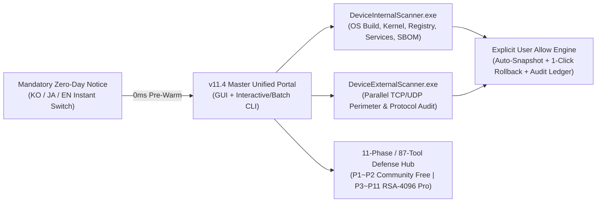

# [★] CVE Security Operations Suite — v11.4 Master Edition

<p align="center">
  <b>🌐 Language / 言語選択 / 언어 선택:</b><br/>
  <a href="README.md"><b>[🇰🇷 한국어 전문 가이드 (README.md)]</b></a> &nbsp;|&nbsp;
  <a href="README.en.md"><b>[🇺🇸 English Full Documentation (Current)]</b></a> &nbsp;|&nbsp;
  <a href="README.ja.md"><b>[🇯🇵 日本語 完全版ドキュメント (README.ja.md)]</b></a>
</p>

---

> **Release Version:** `v11.4 Master Edition (Build 11.4.0.0)`  
> **CVE DB Baseline:** `2026-10-29` | **Cumulative Coverage:** `248,890 CVEs (100.00% Mapped / 520 Deep Live Signatures per Scanner)`  
> **Languages & Typography:** `English (Segoe UI)` · `한국어 (Malgun Gothic)` · `日本語 (OSS Noto Sans JP)` (`< 30ms` Instant Dynamic Switch)  
> **Binary Integrity & Protection:** `RSA-2048 Strong-Name Signed (Token: efa16b5fcb79fdf2)` · `[SuppressIldasm]` · `RSA-4096 Pro License Verification`  
> **Official Portable Download:** [**CVE_Security_Operations_Suite_Portable.zip**](releases/CVE_Security_Operations_Suite_Portable.zip) &nbsp;|&nbsp; [**SHA256SUMS.txt**](SHA256SUMS.txt)  
> **Official Repository:** [https://github.com/anon-wu/CVE_Checker_Anon_X](https://github.com/anon-wu/CVE_Checker_Anon_X)  
> **Official Contact & Pro/Enterprise Licensing:** `jayd424000@gmail.com`

---

## Table of Contents

1. [Overview & System Architecture](#1-overview--system-architecture)
2. [Browser-Safe Download & SHA-256 Integrity Verification Guide](#2-browser-safe-download--sha-256-integrity-verification-guide)
3. [Dual-Scanner Architecture Comparison (Host vs. Network Perimeter)](#3-dual-scanner-architecture-comparison-host-vs-network-perimeter)
4. [Edition Comparison (Community vs. Pro / Enterprise)](#4-edition-comparison-community-vs-pro--enterprise)
5. [11-Phase / 87-Tool Autonomous Cyber Defense Matrix](#5-11-phase--87-tool-autonomous-cyber-defense-matrix)
6. [Global 21+ Antivirus & Enterprise EDR Zero-Conflict Coexistence](#6-global-21-antivirus--enterprise-edr-zero-conflict-coexistence)
7. [Quick Start & Unattended CLI / CI-CD Automation Guide](#7-quick-start--unattended-cli--ci-cd-automation-guide)
8. [Anti-Reverse-Engineering & Binary Integrity Architecture](#8-anti-reverse-engineering--binary-integrity-architecture)
9. [License Policy & Official Contact](#9-license-policy--official-contact)

---

## 1. Overview & System Architecture

**CVE Security Operations Suite v11.4 Master Edition** is an all-in-one, zero-dependency portable cyber security auditing and remediation suite for Windows. It performs deep, real-time vulnerability diagnostics across internal endpoint configurations (**`DeviceInternalScanner.exe` — Host Audit**) and external network boundaries (**`DeviceExternalScanner.exe` — Perimeter Audit**), executing automated hardening and 1-click snapshot rollbacks strictly under explicit user authorization (**`[Allow]`**).

Built on the native Windows `.NET Framework 4.8` runtime (standard Windows GUI subsystem) with zero external packages or background agents required, the suite provides both a **Free Forever Community Edition** for personal, academic, and non-profit use and a **Commercial Pro & Enterprise Edition** unlocking all **87 defense tools across 11 architectural phases**.



### [★] Four Mandatory Security Principles

1. **Official CVE Database-Backed Live Auditing**: Every vulnerability check and remediation rule operates strictly against officially cataloged **CVE (Common Vulnerabilities and Exposures)** intelligence (`248,890` cumulative CVEs as of `2026-10-29`, mapped `100.00%` across `520` deep live signature clusters per scanner).
2. **Transparent Zero-Day Attack Disclosure**: Undisclosed **Zero-Day Attacks** for which no official CVE advisory, patch, or mitigation has yet been published cannot be diagnosed by definition. Both the startup security notice and CLI banner disclose this limitation transparently before every session.
3. **Explicit User `Allow` & Guaranteed Rollback**: The suite never makes silent background modifications to your operating system. Every finding displays concrete telemetry evidence and the exact remediation action, executing changes only after explicit **`[Allow]`** confirmation and automatic pre-change snapshot backup.
4. **Instant Pre-Warmed Startup & Native Trilingual Typography**: Asynchronous catalog pre-warming launches the main portal immediately upon accepting the startup notice. Real-time language switching updates all views and all **87 tool dialogs** in `< 30ms` without window handle recreation, using native **`Segoe UI`** (English), **`Malgun Gothic`** (Korean), and open-source **`Noto Sans JP`** (Japanese).

---

## 2. Browser-Safe Download & SHA-256 Integrity Verification Guide

`v11.4 Master Edition` follows strict release-engineering standards for seamless compatibility with Microsoft Edge, Google Chrome, Mozilla Firefox download scanners, and Microsoft Defender:

- **Script-Free Clean Release Archive**: [`releases/CVE_Security_Operations_Suite_Portable.zip`](releases/CVE_Security_Operations_Suite_Portable.zip) contains **only** the two official Windows GUI executables (`DeviceInternalScanner.exe`, `DeviceExternalScanner.exe`), trilingual documentation (`README.md`, `README.en.md`, `README.ja.md`), license terms (`LICENSE.txt`), and cryptographic checksums (`SHA256SUMS.txt`). It contains **zero** `.ps1`, `.bat`, or `.vbs` scripts and **zero** antivirus-preference modification commands that trigger false-positive browser download blocks.
- **Standard Windows GUI Subsystem & RSA-2048 Assembly Signing**: Compiled as standard Windows GUI executables (`/target:winexe`) with embedded multi-resolution Win32 icons, complete PE `VERSIONINFO` (`11.4.0.0`), and an RSA-2048 Strong-Name signature (`PublicKeyToken: efa16b5fcb79fdf2`).

### Download & Cryptographic Verification Steps (PowerShell)

1. Click [**CVE_Security_Operations_Suite_Portable.zip**](releases/CVE_Security_Operations_Suite_Portable.zip) (click **`Download raw file`** on the GitHub file page) or clone the repository via `git clone`.
2. Extract the archive and verify binary SHA-256 hashes against [`SHA256SUMS.txt`](SHA256SUMS.txt):

```powershell
# 1. Clear Mark-of-the-Web (if downloaded via browser) and extract the portable archive
Unblock-File -Path .\CVE_Security_Operations_Suite_Portable.zip -ErrorAction SilentlyContinue
Expand-Archive -Path .\CVE_Security_Operations_Suite_Portable.zip -DestinationPath .\CVE_Suite -Force

# 2. Verify cryptographic SHA-256 checksums against SHA256SUMS.txt
Get-FileHash -Path .\CVE_Suite\*.exe -Algorithm SHA256 | Format-Table Algorithm, Hash, Path -AutoSize
Get-Content .\CVE_Suite\SHA256SUMS.txt
```

> **Note on Windows SmartScreen**: When running a newly released portable executable for the first time, if Windows SmartScreen displays *"Windows protected your PC"*, verify that your `Get-FileHash` output matches `SHA256SUMS.txt`, then click **`[More info]` ➔ `[Run anyway]`** (or run `Unblock-File` as shown above).

---

## 3. Dual-Scanner Architecture Comparison (Host vs. Network Perimeter)

| Capability | `DeviceInternalScanner.exe` (Internal Host Audit) | `DeviceExternalScanner.exe` (Network Perimeter Audit) |
| :--- | :--- | :--- |
| **Primary Audit Scope** | OS kernel & build baseline, security registry hives, system services, privilege escalation (EoP) vectors, local group policy, installed software SBOM | Externally reachable TCP/UDP ports, SMB/RDP/WinRM/RPC/TLS/UPnP/SNMP network protocols, and firewall perimeter exposure |
| **Built-In Signatures** | `520` live host signature clusters (`248,890` CVEs mapped) | `520` live perimeter signature clusters (`248,890` CVEs mapped) |
| **3-Tier Scan Modes** | **Fast (CISA KEV Critical)** · **Normal** · **Full (All 520 Clusters)** | **Fast (High-Risk Ports)** · **Normal** · **Full (Parallel Deep Probe)** |
| **Remediation Mechanism** | Applies approved (`Allow`) registry/service hardening after saving pre-change state snapshot | Applies approved (`Allow`) protocol lockdown & perimeter mitigation after saving state snapshot |
| **1-Click Rollback** | Full 1-Click state restoration via built-in Snapshot Rollback Manager | Full 1-Click state restoration via built-in Snapshot Rollback Manager |

---

## 4. Edition Comparison (Community vs. Pro / Enterprise)

| Capability | Community Edition (Free Public) | Pro / Enterprise Edition (Commercial) |
| :--- | :--- | :--- |
| **Licensing Policy** | Free forever for personal, academic, and non-profit use (zero registration) | Commercial Serial Key (`PRO-...` / `ENT-...`) or **RSA-4096 Signed Air-Gap `.lic` Certificate** |
| **Host & Perimeter CVE Engine** | All 520 live signature clusters (`Fast` / `Normal` / `Full` scan tiers) | All 520 clusters + offline custom `.cvedb` hot-updates & fleet orchestration |
| **CVE Intelligence Baseline** | `2026-10-29` (`248,890` CVEs `100.00%` mapped) | `2026-10-29` + priority air-gap / private mirror feed updates |
| **Security Tools Hub** | **Phase 1 – Phase 2 Core Defense Tools (15 Tools Free)** | **All Phase 1 – Phase 11 Enterprise Defense Tools (All 87 Tools Unlocked)** |
| **Remediation & Rollback** | Explicit `Allow` remediation & snapshot state restoration | Unlimited snapshot rollbacks + RFC 3161 / WORM Merkle-tree immutable audit ledger |
| **Executive & Audit Reports** | Interactive HTML5 Executive Report (PDF print-ready), UTF-8 CSV, JSON | KISA Critical Infrastructure · ISMS-P · CIS Benchmark · ISO/IEC 27001 Compliance Certificates |
| **AV & EDR Coexistence** | 100% zero-conflict coexistence with 21+ global AV/EDR platforms | Enterprise EDR (CrowdStrike / SentinelOne / Cortex XDR) SHA-256 hash allowlist integration |

---

## 5. 11-Phase / 87-Tool Autonomous Cyber Defense Matrix

| Phase | Architectural Defense Domain | Tool IDs | Edition | Representative Core Capabilities |
| :---: | :--- | :---: | :---: | :--- |
| **Phase 1** | Core Live Audit & Rollback | `#1 ~ #7` | **Community (Free)** | Snapshot Rollback Manager, HTML5/CSV/JSON Exporter, Real-Time Sentinel Guard, Subnet Discovery, SBOM Auditor, `.cvedb` Hot-Updater, Attack Path Analyzer |
| **Phase 2** | Deep Host Audit & Compliance | `#8 ~ #15` | **Community (Free)** | Port-to-PID Signature Tracer, Group Policy Hardening, KISA/CIS/ISO27001 Compliance Certificates, Historical Scan Diff, Autoruns Startup Auditor, Integrity Monitor |
| **Phase 3** | Enterprise Zero-Trust Security | `#16 ~ #23` | **Pro / Enterprise** | AI Threat Explainer, Micro-Segmentation Firewall, TPM/SecureBoot Attestation, Memory Mitigation Guard, SIEM Webhook Connector, Air-Gap Patch Bundler, AD Auditor, 3D Topology |
| **Phase 4** | Active Defense & SOAR Automation | `#24 ~ #31` | **Pro / Enterprise** | Canary Integrity Trap Monitor, WMI/AMSI Script Auditor, MITRE ATT&CK Navigator, Cloud Workload Posture, Schannel TLS Hardening, Windows Sandbox Verifier, PQC Readiness, SOAR Playbooks |
| **Phase 5** | AI Self-Healing & Forensics | `#32 ~ #39` | **Pro / Enterprise** | Kernel Driver BYOVD Auditor, Browser/Credential Vault Shield, Container/WSL2 Isolation, Neural Anomaly Detector, eBPF/ETW Telemetry, Memory Forensics, Supply-Chain Signer Check, Self-Healing Engine |
| **Phase 6** | Post-Quantum Cryptography (PQC) | `#40 ~ #47` | **Pro / Enterprise** | NIST FIPS 203/204 ML-KEM (Kyber) & ML-DSA (Dilithium) Migration, Crypto-Agility Inventory, Hybrid TLS Validator, QRNG Entropy Auditor, HNDL Protection, HSM Key Lifecycle |
| **Phase 7** | Critical Infrastructure & OT/ICS | `#48 ~ #55` | **Pro / Enterprise** | SCADA/Modbus/DNP3 Protocol Guard, Unidirectional Data Diode Verifier, Air-Gap Physical Channel Auditor, Merkle-Tree WORM Forensic Ledger, Defense Posture Validator |
| **Phase 8** | Autonomous Cognitive Defense | `#56 ~ #63` | **Pro / Enterprise** | Autonomous Mitigation Synthesis Verifier, Adversarial AI Model Integrity Guard, Zero-Knowledge Proof (ZKP) State Attestation, Homomorphic Telemetry, Consensus Defense |
| **Phase 9** | Aerospace & Next-Gen Interfaces | `#64 ~ #71` | **Pro / Enterprise** | LEO Satellite Optical ISL Link Security, Ultra-Low-Latency Ed25519 Biometric/Neural Telemetry Verification, 6G Terahertz Physical-Layer Auth, Autonomous V2X Security |
| **Phase 10** | Precision Timing & Causal Ledger | `#72 ~ #79` | **Pro / Enterprise** | PTP/NTP Nanosecond Time-Spoofing Defense, Distributed Vector-Clock Causal Auditor, Immutable State Checkpointing, Multi-Path Byzantine Fault Tolerant (BFT) Verification |
| **Phase 11** | Unified Master Governance | `#80 ~ #87` | **Pro / Enterprise** | Cross-Domain Threat Orchestrator, Formal-Verification Policy Engine, Global Regulatory Autonomous Mapper, Zero-Defect Master Health Auditor |

---

## 6. Global 21+ Antivirus & Enterprise EDR Zero-Conflict Coexistence

CVE Security Operations Suite is engineered on a **100% non-intrusive User-Mode Standard Win32 / .NET API architecture** — loading **zero** kernel drivers (`.sys`), performing **zero** cross-process memory injections or API hooks, and executing **zero** antivirus-tampering commands. Consequently, BSOD and security-agent conflict risk is **`0.00%`**.

Click the **`[AV] Global Antivirus (21+)`** button in the top header bar at any time to view active security engines detected on your host, copy live **SHA-256 binary integrity hashes**, and view vendor-specific manual allowlist navigation guides.

| Security Platform (>= 1% Global Market Share Coverage) | Official Console / UI Manual Allowlist Navigation Path |
| :--- | :--- |
| **Microsoft Defender Antivirus** | `Windows Security` ➔ `Virus & threat protection` ➔ `Manage settings` ➔ `Add or remove exclusions` |
| **CrowdStrike Falcon (EDR)** | `Falcon Console` ➔ `Configuration` ➔ `Exclusions (Custom IOA / Sensor / SHA-256 Hash)` |
| **SentinelOne Singularity (EDR)** | `Management Console` ➔ `Sentinels` ➔ `Policy` ➔ `Exclusions (Interoperability Mode)` |
| **Palo Alto Cortex XDR** | `Endpoints` ➔ `Policy Management` ➔ `Prevention` ➔ `Exceptions` |
| **Symantec / Norton 360** | `Settings` ➔ `Antivirus` ➔ `Scans and Risks` ➔ `Exclusions / Low Risks` |
| **McAfee / Trellix Endpoint Security** | `Threat Prevention` / `My Protection` ➔ `Real-Time Scanning` ➔ `Excluded Files` |
| **Trend Micro Apex One / Vision One** | `Policies` ➔ `Exceptions` ➔ `Approved List (Path / Process)` |
| **Sophos Intercept X** | `Global Settings` ➔ `Global Exclusions` ➔ `Add Exclusion` |
| **Bitdefender Total Security / GravityZone** | `Protection` / `Policies` ➔ `Antivirus` ➔ `Settings` ➔ `Manage Exceptions` |
| **ESET PROTECT / NOD32** | `Advanced Setup (F5)` ➔ `Detection Engine` ➔ `Exclusions` |
| **Kaspersky Endpoint / Plus** | `Settings` ➔ `Security Settings` ➔ `Threats and Exclusions` ➔ `Manage Exclusions` |
| **Malwarebytes / ThreatDown** | `Settings` ➔ `Allow List` ➔ `Add Folder` |
| **Avast / AVG Security** | `Menu` ➔ `Settings` ➔ `General` ➔ `Exceptions` |
| **Cisco Secure Endpoint · Carbon Black · Check Point · Fortinet · Cybereason** | Register folder path or binary `SHA-256` hash under `Policy Exclusions` in the enterprise console |
| **AhnLab V3 (IS / ES / Lite)** | `Settings (Gear Icon)` ➔ `Scan Exceptions` ➔ `Excluded Targets` ➔ `Add Folder` |
| **ESTsecurity ALYac** | `Preferences` ➔ `Detection Exclusions` ➔ `Add Folder / File` |

---

## 7. Quick Start & Unattended CLI / CI-CD Automation Guide

### 7.1 Instant Portable GUI Launch (Zero Installation)

```powershell
# 1. Extract the portable release bundle
Expand-Archive -Path .\releases\CVE_Security_Operations_Suite_Portable.zip -DestinationPath .\CVE_Suite -Force

# 2. Launch Internal Host Vulnerability Auditor
.\CVE_Suite\DeviceInternalScanner.exe

# 3. Launch External Network Perimeter Vulnerability Auditor
.\CVE_Suite\DeviceExternalScanner.exe
```

### 7.2 Unattended CLI & CI/CD Pipeline Automation Commands

```powershell
# Display full CLI usage and options
.\DeviceInternalScanner.exe --help

# [Internal Host Audit] Run Full 520-cluster scan and export JSON audit report in unattended batch mode
.\DeviceInternalScanner.exe --scan-tier full --lang en --output-format json --output-path .\reports\internal_audit.json --batch

# [External Perimeter Audit] Run Fast scan against a target IP and export an HTML5 executive report (English)
.\DeviceExternalScanner.exe --target 127.0.0.1 --scan-tier fast --lang en --output-format html --output-path .\reports\perimeter_en.html --batch

# [UTF-8 CSV Audit Ledger] Run Normal scan and export CSV report (Japanese example)
.\DeviceInternalScanner.exe --scan-tier normal --lang ja --output-format csv --output-path .\reports\internal_ja.csv --batch

# [Attack-Chain & SBOM] Analyze Top 3 multi-stage attack paths and audit installed software SBOM
.\DeviceInternalScanner.exe --tier normal --attack-chain --batch
.\DeviceInternalScanner.exe --sbom --batch

# [Explicit Allow Remediation & Rollback] Remediate a specific CVE (with auto-snapshot) and restore latest snapshot
.\DeviceInternalScanner.exe --allow CVE-2026-43990 --batch
.\DeviceInternalScanner.exe --rollback latest --batch
```

---

## 8. Anti-Reverse-Engineering & Binary Integrity Architecture

To prevent unauthorized tampering, counterfeit builds, or abuse of the vulnerability auditing and commercial licensing engines, the distributed executables implement **standard Microsoft commercial `.NET` hardening** without malware-style packers that trigger false positives:

1. **RSA-2048 Strong-Name Cryptographic Assembly Signing (`PublicKeyToken: efa16b5fcb79fdf2`)**: Both executables are cryptographically signed with an offline 2048-bit RSA Strong-Name key. Modifying a single byte of IL or stripping the Strong-Name signature immediately invalidates the runtime integrity digest and locks protected modules.
2. **Disassembly Suppression (`[SuppressIldasm]`) & Release Metadata Minification**: Blocks standard `ildasm.exe` disassembly, strips all `.pdb` debug symbols (`/optimize+ /debug- /deterministic`), and applies Roslyn SemanticModel symbol minification so internal class, method, field, and parameter names are never exposed.
3. **Strong-Name-Bound RSA-4096 Asymmetric Air-Gap License Verification**: Commercial `.lic` certificates are verified using an air-gapped RSA-4096 digital signature whose public-key parameters are cryptographically bound to the binary's RSA-2048 Strong-Name digest, defeating hex-editor public-key swap attacks.
4. **Protected Distribution Model**: Only verified, Strong-Name-signed release packages, trilingual documentation, and `SHA256SUMS.txt` manifests are published to the public repository to prevent source-code cloning abuse and license tampering.

---

## 9. License Policy & Official Contact

- **Community Edition (Free Public Release)**: Free for personal, academic, research, and non-profit use (see [`LICENSE.txt`](LICENSE.txt)).
- **Pro & Enterprise Commercial Licensing**: For corporate/government deployment, multi-node volume quotes, tax invoices, **RSA-4096 signed air-gapped `.lic` certificate issuance**, and dedicated technical support, please contact our official licensing desk:
- **Official Contact Email**: `jayd424000@gmail.com`
- **Copyright**: Copyright © 2026 CVE Security Operations Project. All rights reserved.
