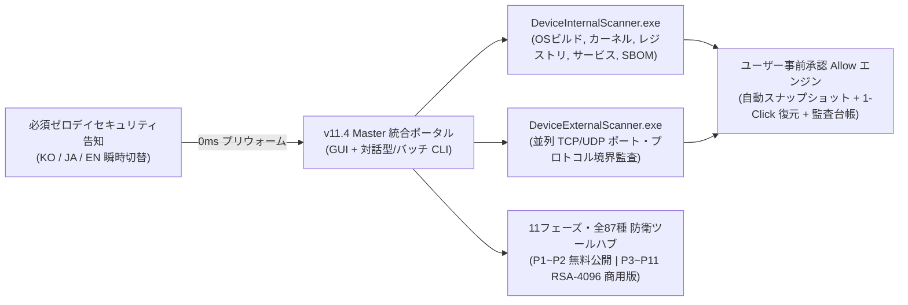

# [★] CVE Security Operations Suite — v11.4 Master Edition

<p align="center">
  <b>🌐 Language / 言語選択 / 언어 선택:</b><br/>
  <a href="README.md"><b>[🇰🇷 한국어 전문 가이드 (README.md)]</b></a> &nbsp;|&nbsp;
  <a href="README.en.md"><b>[🇺🇸 English Full Documentation (README.en.md)]</b></a> &nbsp;|&nbsp;
  <a href="README.ja.md"><b>[🇯🇵 日本語 完全版ドキュメント (現在のページ)]</b></a>
</p>

---

> **リリースバージョン:** `v11.4 Master Edition (Build 11.4.0.0)`  
> **CVE DB 基準日:** `2026-10-29` | **累計カバー範囲:** `248,890件のCVE (100.00% マッピング / スキャナあたり520種の深層実測シグネチャ)`  
> **対応言語・フォント:** `日本語 (OSS Noto Sans JP 均一高視認性フォント)` · `한국어 (Malgun Gothic)` · `English (Segoe UI)` (`< 30ms` 瞬時切替)  
> **バイナリ整合性・保護:** `RSA-2048 Strong-Name 電子署名 (Token: efa16b5fcb79fdf2)` · `[SuppressIldasm]` · `RSA-4096 商用ライセンス検証`  
> **公式ポータブル版ダウンロード:** [**CVE_Security_Operations_Suite_Portable.zip**](releases/CVE_Security_Operations_Suite_Portable.zip) &nbsp;|&nbsp; [**SHA256SUMS.txt**](SHA256SUMS.txt)  
> **公式 GitHub リポジトリ:** [https://github.com/anon-wu/CVE_Checker_Anon_X](https://github.com/anon-wu/CVE_Checker_Anon_X)  
> **公式お問い合わせ・Pro/Enterprise 法人ライセンス窓口:** `jayd424000@gmail.com`

---

## 目次 (Table of Contents)

1. [概要およびシステムアーキテクチャ](#1-概要およびシステムアーキテクチャ)
2. [ブラウザからの安全なダウンロードおよび SHA-256 整合性検証ガイド](#2-ブラウザからの安全なダウンロードおよび-sha-256-整合性検証ガイド)
3. [デュアル診断エンジン詳細比較（ホスト内部診断 vs. 外部ネットワーク境界診断）](#3-デュアル診断エンジン詳細比較ホスト内部診断-vs-外部ネットワーク境界診断)
4. [エディション別機能比較（Community 無料版 vs. Pro / Enterprise 商用版）](#4-エディション別機能比較community-無料版-vs-pro--enterprise-商用版)
5. [11フェーズ・全87種 自律サイバー防衛ツールマトリクス](#5-11フェーズ全87種-自律サイバー防衛ツールマトリクス)
6. [世界主要21種以上のウイルス対策ソフト・法人 EDR との完全無干渉共存](#6-世界主要21種以上のウイルス対策ソフト法人-edr-との完全無干渉共存)
7. [クイックスタートおよび CLI / CI-CD 無人自動化ガイド](#7-クイックスタートおよび-cli--ci-cd-無人自動化ガイド)
8. [リバースエンジニアリング防止およびバイナリ整合性保護設計](#8-リバースエンジニアリング防止およびバイナリ整合性保護設計)
9. [ライセンスポリシーおよび公式お問い合わせ窓口](#9-ライセンスポリシーおよび公式お問い合わせ窓口)

---

## 1. 概要およびシステムアーキテクチャ

**CVE Security Operations Suite v11.4 Master Edition** は、エンドポイント端末内部の構成監査（**`DeviceInternalScanner.exe` — Host Audit**）と外部ネットワーク境界の露出監査（**`DeviceExternalScanner.exe` — Perimeter Audit**）を高精度に実測し、ユーザーの明示的な事前承認（**`[許可 / Allow]`**）のもとでワンクリック自動修復およびスナップショット復元（ロールバック）を実行する**オールインワン・ポータブル統合サイバーセキュリティスイート**です。

Windows 標準搭載の `.NET Framework 4.8` ランタイム（標準 Windows GUI サブシステム）上で動作し、外部パッケージや常駐エージェントのインストールは一切不要です。個人・教育・非営利環境向けの**永久無料公開版（Community Edition）**と、**全11フェーズ・87種の専門防衛ツール群**を完全解放する**商用プロ／エンタープライズ版（Pro & Enterprise Edition）**の両方をサポートしています。



### [★] 4大必須セキュリティ告知および設計原則

1. **公式 CVE データベースに基づく実測診断**: 本スイートのすべての脆弱性診断および修復処理は、公式登録された **CVE（Common Vulnerabilities and Exposures）** データベース（`2026-10-29` 基準・累計 `248,890` 件、スキャナあたり `520` 種の深層実測シグネチャへ `100.00%` マッピング）に基づいて動作します。
2. **ゼロデイ攻撃（Zero-Day Attack）診断不可の事前明示**: 公式パッチや緩和策が未公開である未知の**ゼロデイ攻撃（Zero-Day Attack）**は原理上診断できません。起動時の必須セキュリティ告知画面および CLI バナーにて、この技術的限界を透明性をもって事前に明示します。
3. **ユーザーの事前承認（`Allow`）と 100% 安全なロールバック原則**: 無断でシステム設定を変更することは一切ありません。検出された脆弱性ごとに具体的な実測根拠と修復コマンドを提示し、ユーザーが明示的に **`[許可 (Allow)]`** を承認した項目のみ、自動スナップショット保存後に安全に適用します。
4. **超高速起動と OSS フォント `Noto Sans JP` による美しい日本語表示**: 非同期カタログ・プリウォーミングにより告知画面の同意直後にメイン画面へ遷移します。さらに日本語表示にはオープンソースフォント **`Noto Sans JP`** を採用し、文字化けや漢字サイズの不均一を完全に解消した上で、韓国語・日本語・英語を `< 30ms` 以内にリアルタイム切り替え可能です。

---

## 2. ブラウザからの安全なダウンロードおよび SHA-256 整合性検証ガイド

`v11.4 Master Edition` は、Microsoft Edge・Google Chrome・Mozilla Firefox などのブラウザのダウンロード検証および Microsoft Defender と完全に調和するよう、以下の**クリーンリリースパッケージ規格**を採用しています。

- **スクリプトを含まない純粋なバイナリ・ドキュメント構成**: [`releases/CVE_Security_Operations_Suite_Portable.zip`](releases/CVE_Security_Operations_Suite_Portable.zip) には、公式ビルドされた Windows GUI 実行ファイル2種（`DeviceInternalScanner.exe`, `DeviceExternalScanner.exe`）、3言語ドキュメント（`README.md`, `README.en.md`, `README.ja.md`）、ライセンス規約（`LICENSE.txt`）、および暗号学的ハッシュ一覧（`SHA256SUMS.txt`）のみが格納されています。ブラウザの誤検知を引き起こす `.ps1` / `.bat` / `.vbs` スクリプトや Defender 設定変更コマンドは一切含まれていません。
- **標準 Windows GUI サブシステムおよび RSA-2048 アセンブリ署名**: 高解像度 Win32 アイコンリソース、正規バージョン情報（`11.4.0.0`）、および RSA-2048 Strong-Name 整合性署名（`PublicKeyToken: efa16b5fcb79fdf2`）が適用されています。

### ダウンロードおよび整合性検証手順（PowerShell）

1. 上部の [**CVE_Security_Operations_Suite_Portable.zip**](releases/CVE_Security_Operations_Suite_Portable.zip) リンクを開き（GitHub ファイル画面右上の **`Download raw file`** をクリック）、または `git clone` で取得します。
2. 展開後、[`SHA256SUMS.txt`](SHA256SUMS.txt) と SHA-256 ハッシュ値を照合してファイルの完全性を確認します：

```powershell
# 1. Webダウンロードブロック識別子(Mark-of-the-Web)の解除およびアーカイブ展開
Unblock-File -Path .\CVE_Security_Operations_Suite_Portable.zip -ErrorAction SilentlyContinue
Expand-Archive -Path .\CVE_Security_Operations_Suite_Portable.zip -DestinationPath .\CVE_Suite -Force

# 2. 実行ファイルの SHA-256 ハッシュ値を計算し SHA256SUMS.txt と照合
Get-FileHash -Path .\CVE_Suite\*.exe -Algorithm SHA256 | Format-Table Algorithm, Hash, Path -AutoSize
Get-Content .\CVE_Suite\SHA256SUMS.txt
```

> **Windows SmartScreen に関するご案内**: 新規公開されたポータブル実行ファイルを初回起動する際、Windows SmartScreen が *「Windows によって PC が保護されました」* と表示する場合は、上記の `SHA256SUMS.txt` ハッシュ一致をご確認の上、**`[詳細情報 (More info)]` ➔ `[実行 (Run anyway)]`** をクリックしてください。

---

## 3. デュアル診断エンジン詳細比較（ホスト内部診断 vs. 外部ネットワーク境界診断）

| 比較項目 | `DeviceInternalScanner.exe`（端末内部・ホスト診断） | `DeviceExternalScanner.exe`（外部ネットワーク境界診断） |
| :--- | :--- | :--- |
| **主要監査対象** | OS カーネル・ビルド番号、セキュリティレジストリ、Windows サービス、権限昇格（EoP）要因、ローカルポリシー、導入済みソフトウェア SBOM | 外部開放 TCP/UDP ポート、SMB/RDP/WinRM/RPC/TLS/UPnP/SNMP 通信プロトコル、およびファイアウォール境界露出 |
| **内蔵シグネチャ数** | `520` 種のホスト実測シグネチャクラスタ（`248,890` 件の CVE 対応） | `520` 種のネットワーク境界シグネチャクラスタ（`248,890` 件の CVE 対応） |
| **3段階スキャンモード** | **高速（Fast — CISA KEV 重要項目）** · **標準（Normal）** · **精密（Full — 全520種）** | **高速（Fast — 高リスクポート）** · **標準（Normal）** · **精密（Full — 並列深層検査）** |
| **自動修復方式** | 事前承認（`Allow`）時のみ変更前スナップショットを保存し、レジストリ／サービス堅牢化を適用 | 事前承認（`Allow`）時のみスナップショットを保存し、脆弱プロトコル遮断・境界保護を適用 |
| **復元（Rollback）** | 内蔵スナップショット管理機能による 1-Click 即時原状回復に対応 | 内蔵スナップショット管理機能による 1-Click 即時原状回復に対応 |

---

## 4. エディション別機能比較（Community 無料版 vs. Pro / Enterprise 商用版）

| 機能区分 | Community Edition（無料公開版） | Pro / Enterprise Edition（商用正規版） |
| :--- | :--- | :--- |
| **ライセンス形態** | 個人・教育・非営利環境にて永久無料（会員登録・インストール不要） | 商用シリアルキー（`PRO-...` / `ENT-...`）および **RSA-4096 署名付き閉鎖網 `.lic` 認証** |
| **内部・外部 CVE 診断エンジン** | 全520種シグネチャ対応（`Fast` / `Normal` / `Full` 全3段階対応） | 全520種 + 閉鎖網カスタム `.cvedb` ホット更新・全社オーケストレーション |
| **CVE DB 基準日** | `2026-10-29`（累計 `248,890` 件 `100.00%` マッピング） | `2026-10-29` + 閉鎖網／プライベートミラー優先配信 |
| **防衛ツールハブ（Tools Hub）** | **Phase 1 ～ Phase 2 コア防衛ツール 15種を無料提供** | **Phase 1 ～ Phase 11 全領域 87種の専門防衛ツールを 100% 完全解放** |
| **自動修復・ロールバック** | 事前承認（`Allow`）ベースの自動修復およびスナップショット復元 | 無制限ロールバック + RFC 3161 / WORM マークルツリー不変監査台帳 |
| **監査レポート出力** | 対話型 HTML5 経営層レポート（PDF 印刷対応）、UTF-8 CSV、JSON | KISA 重要インフラ・ISMS-P・CIS Benchmark・ISO/IEC 27001 適合性証明書 |
| **ウイルス対策・EDR 共存** | 世界シェア 1% 以上の主要 21種+ ウイルス対策／EDR と 100% 無干渉共存 | 法人 EDR（CrowdStrike / SentinelOne 等）向け SHA-256 ハッシュ許可管理 |

---

## 5. 11フェーズ・全87種 自律サイバー防衛ツールマトリクス

| Phase | 防衛アーキテクチャ領域 | ツール番号 | 提供区分 | 代表的な主要機能 |
| :---: | :--- | :---: | :---: | :--- |
| **Phase 1** | コア実測診断・ロールバック | `#1 ~ #7` | **Community (無料)** | スナップショット復元管理、HTML5/CSV/JSON 出力、リアルタイム Sentinel Guard、サブネット探索、SBOM 監査、`.cvedb` 更新、攻撃経路（Kill-Chain）分析 |
| **Phase 2** | 深層ホスト監査・コンプライアンス | `#8 ~ #15` | **Community (無料)** | 開放ポート占有 PID／署名追跡、グループポリシー堅牢化、KISA/CIS/ISO27001 証明書、時系列 Diff 比較、Autoruns 起動監査、整合性モニタ |
| **Phase 3** | エンタープライズ・ゼロトラスト | `#16 ~ #23` | **Pro / Enterprise** | AI 脅威解説エンジン、マイクロセグメンテーション、TPM/SecureBoot 検証、メモリ保護ガード、SIEM Webhook 連携、閉鎖網パッチバンドラ、AD 監査、3D トポロジ |
| **Phase 4** | 能動防衛・SOAR 自動化 | `#24 ~ #31` | **Pro / Enterprise** | カナリア整合性トラップ監視、WMI/AMSI スクリプト監査、MITRE ATT&CK ナビゲータ、クラウド保護、Schannel TLS 堅牢化、Sandbox 検証、PQC 準備度、SOAR プレイブック |
| **Phase 5** | AI 自己修復・フォレンジック | `#32 ~ #39` | **Pro / Enterprise** | カーネルドライバ BYOVD 監査、資格情報ボールト保護、コンテナ／WSL2 隔離、ニューラル異常検知、eBPF/ETW テレメトリ、メモリ解析、サプライチェーン署名検証、自己修復 |
| **Phase 6** | 耐量子計算機暗号（PQC）移行 | `#40 ~ #47` | **Pro / Enterprise** | NIST FIPS 203/204 ML-KEM(Kyber)/ML-DSA(Dilithium) 移行、暗号アジリティ資産台帳、ハイブリッド TLS 検証、QRNG エントロピー監査、HNDL 防御、HSM 鍵管理 |
| **Phase 7** | 重要インフラ・OT/ICS 防衛 | `#48 ~ #55` | **Pro / Enterprise** | SCADA/Modbus/DNP3 プロトコル保護、単方向データダイオード検証、エアギャップ物理漏洩監査、マークルツリー WORM 不変証拠台帳、防衛態勢検証シミュレータ |
| **Phase 8** | 自律認知型防衛システム | `#56 ~ #63` | **Pro / Enterprise** | 自律緩和ポリシー合成検証、敵対的 AI モデル整合性防御、ゼロ知識証明（ZKP）状態検証、準同型暗号テレメトリ、分散コンセンサス防衛 |
| **Phase 9** | 宇宙・航空・次世代通信防衛 | `#64 ~ #71` | **Pro / Enterprise** | 低軌道（LEO）衛星光 ISL リンク保護、超低遅延 Ed25519 生体／神経信号署名検証、6G テラヘルツ物理層認証、自動運転 V2X 通信セキュリティ |
| **Phase 10** | 超高精度時刻同期・因果整合性 | `#72 ~ #79` | **Pro / Enterprise** | PTP/NTP ナノ秒時刻スプーフィング防御、分散ベクタークロック因果順序監査、不変ステートチェックポイント、マルチパス BFT（ビザンチン障害耐性）検証 |
| **Phase 11** | 統合マスター・ガバナンス | `#80 ~ #87` | **Pro / Enterprise** | 全領域統合脅威オーケストレータ、形式検証（Formal Verification）ポリシーエンジン、国際規制自律マッピング、ゼロ欠陥マスターヘルス監査 |

---

## 6. 世界主要21種以上のウイルス対策ソフト・法人 EDR との完全無干渉共存

本スイートは、カーネルドライバ（`.sys`）のロード、他プロセスへのメモリインジェクションや API フック、およびセキュリティ設定の強制変更コマンドを**一切使用しない 100% ユーザーモード（標準 Win32 / .NET API）非侵襲アーキテクチャ**で設計されており、ブルースクリーン（BSOD）やセキュリティエージェントとの競合リスクは **`0.00%`** です。

画面上部ヘッダーの **`[AV] セキュリティ共存 (21種+)`** ボタンをクリックすると、稼働中のセキュリティエンジンを自動検出し、実行ファイルのリアルタイム **SHA-256 ハッシュのコピー**および各製品の手動許可設定手順を確認できます。

| セキュリティ製品（世界シェア 1% 以上を網羅） | 公式コンソール／UI における手動許可（除外）設定パス |
| :--- | :--- |
| **Microsoft Defender Antivirus** | `Windows セキュリティ` ➔ `ウイルスと脅威の防止` ➔ `設定の管理` ➔ `除外の追加または削除` |
| **CrowdStrike Falcon (EDR)** | `Falcon Console` ➔ `Configuration` ➔ `Exclusions (Custom IOA / Sensor / SHA-256 Hash)` |
| **SentinelOne Singularity (EDR)** | `Management Console` ➔ `Sentinels` ➔ `Policy` ➔ `Exclusions (Interoperability モード)` |
| **Palo Alto Cortex XDR** | `Endpoints` ➔ `Policy Management` ➔ `Prevention` ➔ `Exceptions` |
| **Symantec / Norton 360（ノートン）** | `設定` ➔ `ウイルス対策` ➔ `スキャンとリスク` ➔ `除外／低リスク` |
| **McAfee / Trellix Endpoint Security** | `Threat Prevention` / `保護` ➔ `リアルタイムスキャン` ➔ `除外ファイル` |
| **Trend Micro Apex One / Vision One** | `ポリシー` ➔ `例外設定` ➔ `承認済みリスト（フォルダ／プロセス）` |
| **Sophos Intercept X** | `Global Settings` ➔ `Global Exclusions` ➔ `Add Exclusion` |
| **Bitdefender Total Security / GravityZone** | `Protection` / `Policies` ➔ `Antivirus` ➔ `Settings` ➔ `Manage Exceptions` |
| **ESET PROTECT / NOD32** | `詳細設定 (F5)` ➔ `検出エンジン` ➔ `除外` |
| **Kaspersky Endpoint / Plus** | `設定` ➔ `セキュリティ設定` ➔ `脅威と除外` ➔ `除外リストの管理` |
| **Malwarebytes / ThreatDown** | `Settings` ➔ `Allow List` ➔ `Add Folder` |
| **Avast / AVG Security** | `メニュー` ➔ `設定` ➔ `一般` ➔ `例外` |
| **Cisco Secure Endpoint · Carbon Black · Check Point · Fortinet · Cybereason** | 各法人管理コンソールの `Policy Exclusions` にてフォルダパスまたは `SHA-256` ハッシュを登録 |
| **AhnLab V3（アンラボ V3 IS / ES / Lite）** | `環境設定（歯車アイコン）` ➔ `検査例外設定` ➔ `検査除外対象` ➔ `フォルダ追加` |
| **ESTsecurity ALYac** | `環境設定` ➔ `検知除外` ➔ `フォルダ／ファイル追加` |

---

## 7. クイックスタートおよび CLI / CI-CD 無人自動化ガイド

### 7.1 ポータブル GUI の即時起動（インストール不要）

```powershell
# 1. ポータブルパッケージの展開
Expand-Archive -Path .\releases\CVE_Security_Operations_Suite_Portable.zip -DestinationPath .\CVE_Suite -Force

# 2. デバイス内部脆弱性診断プログラムの起動 (Host Audit)
.\CVE_Suite\DeviceInternalScanner.exe

# 3. デバイス外部ネットワーク境界脆弱性診断プログラムの起動 (Perimeter Audit)
.\CVE_Suite\DeviceExternalScanner.exe
```

### 7.2 CLI および CI/CD パイプライン無人自動化コマンド

```powershell
# ヘルプおよび全 CLI オプション一覧の表示
.\DeviceInternalScanner.exe --help

# [端末内部診断] 全520種の精密(Full)スキャンを実行し、日本語 JSON 監査レポートを出力（無人バッチモード）
.\DeviceInternalScanner.exe --scan-tier full --lang ja --output-format json --output-path .\reports\internal_audit_ja.json --batch

# [外部境界診断] 指定ターゲット IP に対して高速(Fast)スキャンを実行し、日本語 HTML5 経営層レポートを生成
.\DeviceExternalScanner.exe --target 127.0.0.1 --scan-tier fast --lang ja --output-format html --output-path .\reports\perimeter_ja.html --batch

# [UTF-8 CSV 監査台帳出力] 標準(Normal)スキャン結果を日本語 CSV で保存
.\DeviceInternalScanner.exe --scan-tier normal --lang ja --output-format csv --output-path .\reports\internal_ja.csv --batch

# [複合攻撃経路 & SBOM] Kill-Chain Top 3 分析および導入済みソフトウェア SBOM 監査
.\DeviceInternalScanner.exe --tier normal --lang ja --attack-chain --batch
.\DeviceInternalScanner.exe --lang ja --sbom --batch

# [事前承認修復 & ロールバック] 特定 CVE の自動修復（スナップショット自動保存）および最新スナップショットからの原状回復
.\DeviceInternalScanner.exe --allow CVE-2026-43990 --batch
.\DeviceInternalScanner.exe --rollback latest --batch
```

---

## 8. リバースエンジニアリング防止およびバイナリ整合性保護設計

脆弱性診断エンジンおよび商用ライセンス認証機構の不正改ざん・悪用（Tampering & Abuse）を防止するため、本配布バイナリにはウイルス対策ソフトの誤検知を招く非標準パッカーを一切用いず、**Microsoft 標準の商用 `.NET` バイナリ保護アーキテクチャ**を適用しています。

1. **RSA-2048 Strong-Name 暗号学的アセンブリ署名（`PublicKeyToken: efa16b5fcb79fdf2`）**: 実行ファイル全体がオフライン管理された 2048 ビット RSA 秘密鍵で署名されています。IL コードの 1 バイトの改ざんや署名除去が行われた場合、実行時整合性検証機構が即座に検知し、商用認証および保護対象モジュールをロックします。
2. **逆アセンブル抑止（`[SuppressIldasm]`）およびメタデータ最小化**: 標準 `ildasm.exe` による逆アセンブルをブロックし、デバッグシンボルを完全除去（`/optimize+ /debug- /deterministic`）した上で、Roslyn SemanticModel による内部シンボル最小化（Minification）により内部クラス・メソッド・フィールド構造の露出を遮断します。
3. **Strong-Name 結合型 RSA-4096 非対称電子署名エアーギャップ認証**: 閉鎖網向け `.lic` 証明書はオフライン秘密鍵による RSA-4096 電子署名で検証され、公開鍵パラメータ自体も Strong-Name 整合性ダイジェストと暗号学的に結合されているため、バイナリエディタによる公開鍵差し替え攻撃を無効化します。
4. **知的財産保護に基づく配布モデル**: 公開リポジトリには検証済みの正規ポータブルバイナリパッケージ、3言語ドキュメント、および `SHA256SUMS.txt` 整合性マニフェストのみを公開し、ソースコード盗用やライセンス迂回悪用を防止しています。

---

## 9. ライセンスポリシーおよび公式お問い合わせ窓口

- **Community Edition（無料公開版）**: 個人、教育機関、学術研究、および非営利目的の環境において無料でご利用いただけます（[`LICENSE.txt`](LICENSE.txt) 参照）。
- **Pro & Enterprise Edition（商用正規ライセンス）**: 法人・官公庁への一括導入、お見積書・適格請求書（インボイス）対応、閉鎖網（エアーギャップ）環境向け **RSA-4096 電子署名付き `.lic` ライセンス証明書の発行**、および技術サポートにつきましては、下記の公式窓口までお問い合わせください。
- **公式お問い合わせメールアドレス**: `jayd424000@gmail.com`
- **Copyright**: Copyright © 2026 CVE Security Operations Project. All rights reserved.
