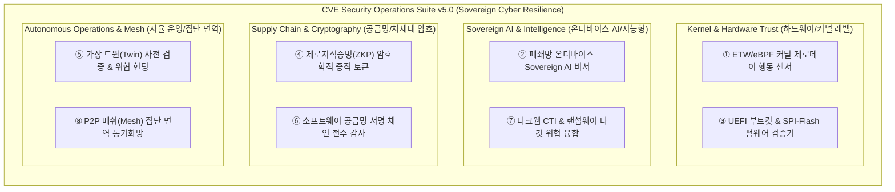

# 🛡️ CVE Security Operations Suite — 제5차 차세대 기능 제안서 (Phase 5 Proposal)

**문서 번호:** SEC-PROP-2026-PHASE5  
**발행일:** 2026년 10월 22일  
**작성자:** Antigravity AI Security Engineering Team  
**수신:** 보안 총괄 관리자 및 개발팀  
**상태:** 제안 승인 대기 (Draft for Review)

---

## 📌 1. 제안 개요 (Executive Summary)

본 문서는 **Phase 1 (핵심 7종 방어)**, **Phase 2 (정밀 8종 감사)**, **Phase 3 (ZTNA & 엔터프라이즈 8종)**, **Phase 4 (자율 기만 & SOAR 8종)** 개발을 성공적으로 완수하고 총 **31종의 차세대 보안 운영 체계**를 확립한 CVE Security Operations Suite의 궁극적 완성 단계인 **제5차 고도화 제안(Phase 5: Sovereign AI & Autonomous Cyber Resilience Ecosystem)**입니다.

이번 5차 제안에서는 **단순 탐지 및 조치를 넘어선 커널 레벨 심층 감시, 온디바이스 소버린 AI, 하드웨어 펌웨어 무결성, 제로지식증명(ZKP) 기반 보안 증적, P2P 집단 면역 메쉬망**을 아우르는 글로벌 최정상급 사이버 레질리언스 기술을 제안합니다.

---

## 🚀 2. 제5차 핵심 제안 기능 (8대 전략 모듈)

---

### 1️⃣ 제1제안: ETW/eBPF 커널 레벨 제로데이 행동 이상 탐지기 (Kernel Behavioral Sensor)
- **배경 및 필요성**: 알려지지 않은 신종 제로데이 공격이나 파일리스 공격은 시그니처 파일이 없어 일반 파일 스캔을 우회합니다.
- **주요 기능**:
  - Windows ETW (`Microsoft-Windows-Kernel-Process`, `Kernel-Network`, `Kernel-Registry`) 실시간 이벤트 커널 드라이버리스 구독.
  - 프로세스 메모리 주입(Process Injection), 토큰 탈취(Token Stealing), Reflective DLL 로딩 등 커널 행동 수준 이상 징후 실시간 차단.
- **기대 효과**: 시그니처가 등록되지 않은 완전 미지의 0-Day 익스플로잇도 즉각적인 실행 단계에서 원천 봉쇄.

---

### 2️⃣ 제2제안: 폐쇄망 온디바이스 소버린 AI 보안 코파일럿 (Air-Gapped Sovereign AI Copilot)
- **배경 및 필요성**: 국가 주요시설 및 국방·금융 폐쇄망에서는 외부 인터넷 클라우드 AI API(OpenAI, Google 등)로 사내 정보가 유출되는 것을 엄격히 금지합니다.
- **주요 기능**:
  - 로컬 온디바이스 소형 거대언어모델(SLM: Phi-3, Gemma-2, Llama-3.2 로컬 엔진) 내장 지원.
  - 인터넷이 완전히 단절된 상태에서도 시스템 취약점에 대한 실시간 대화형 원인 분석, 보안 질의응답 및 맞춤형 파워셸/레지스트리 방어 스크립트 무결성 생성.
- **기대 효과**: 민감 기밀 데이터의 외부 유출 가능성 0% 달성 및 폐쇄망 내부 자율 지능화.

---

### 3️⃣ 제3제안: 하드웨어 펌웨어 SPI-Flash 및 UEFI 부트킷 실측 감사기 (UEFI Bootkit Verifier)
- **배경 및 필요성**: OS를 포맷하고 재설치해도 살아남는 최상위 영구 침투 악성코드(BlackLotus, CosmicStrand 등 UEFI 부트킷) 대응 필요.
- **주요 기능**:
  - SPI-Flash 롬 무결성 해시 분석 및 WPBT (Windows Platform Binary Table) 악성 바이너리 주입 검사.
  - UEFI Secure Boot 변조 탐지, 서명되지 않은 부트 로더 체인 추적 및 BCD(Boot Configuration Data) 디버그 백도어 감사.
- **기대 효과**: 운영체제 하부 하드웨어 계층부터 보장되는 절대적 무결성(Root of Trust) 확립.

---

### 4️⃣ 제4제안: 제로지식증명(ZKP) 및 암호화 증적 인증서 발급기 (Zero-Knowledge Attestation)
- **배경 및 필요성**: 외부 감사기관이나 협력업체에 기기의 완벽한 보안 준수 사실을 증명해야 하지만, 기기 내부 호스트명, 사설 IP, 사용자 계정 등 기밀 데이터는 유출할 수 없습니다.
- **주요 기능**:
  - 제로지식증명(ZKP) 암호학적 증명 메커니즘을 적용하여 민감한 세부 정보를 숨긴 채 "모든 CVE 취약점 0건 및 KISA 가이드라인 100% 준수" 사실만을 수학적으로 증명하는 Ed25519 디지털 서명 증적 토큰 생성.
  - 블록체인 타임스탬프 또는 제3자 공개 검증 키를 통한 위변조 불가능한 인증 체계.
- **기대 효과**: 기밀 누설 없는 완벽한 대외 보안 규제 감사 통과 및 신뢰도 극대화.

---

### 5️⃣ 제5제안: 자율 위협 헌팅 & 디지털 트윈(Digital Twin) 사전 패치 시뮬레이터
- **배경 및 필요성**: 취약점 자동 패치(Allow Fix)를 실행할 때 업무 필수 애플리케이션과의 충돌이나 블루스크린 등 부작용에 대한 우려 해소.
- **주요 기능**:
  - 실제 호스트에 레지스트리/방화벽 변경을 적용하기 전, 메모리 내 디지털 트윈(가상 시스템 환경)에서 사전 적용 충돌 시뮬레이션 수행.
  - 잠복 IOC(침해지표) 및 비인가 파일 변경을 백그라운드에서 상시 사냥(Autonomous Threat Hunting).
- **기대 효과**: 패치 부작용 리스크 0% 달성 및 비즈니스 연속성(Business Continuity) 완벽 보장.

---

### 6️⃣ 제6제안: 소프트웨어 공급망(SBOM) 서명 체인 심층 검증기 (Supply Chain Authenticode Verifier)
- **배경 및 필요성**: SolarWinds, XZ Utils 등 정상 소프트웨어 배포 경로를 통해 유입되는 공급망 공격(Supply Chain Attack) 급증.
- **주요 기능**:
  - 기기에 설치된 모든 실행 바이너리의 Authenticode 디지털 서명 체인, 공인 인증서 유효성 및 OCSP/CRL 폐기 상태 실시간 교차 검증.
  - 패키지 의존성 트리에 알려진 취약점 컴포넌트가 포함되었는지 SBOM 규격(CycloneDX/SPDX) 심층 대조.
- **기대 효과**: 서명되지 않았거나 변조된 위조 서명 바이너리의 즉시 식별 및 공급망 오염 차단.

---

### 7️⃣ 제7제안: 다크웹 CTI 위협 피드 융합 엔진 (DarkWeb CTI Integration)
- **배경 및 필요성**: CVE 번호가 동일하더라도 실제 다크웹에서 랜섬웨어 갱단이 활발히 무기화하고 있는 취약점을 먼저 조치해야 방어 효율이 극대화됩니다.
- **주요 기능**:
  - CISA KEV(Known Exploited Vulnerabilities) 및 최신 다크웹 포럼 위협 인텔리전스 피드 연동.
  - 취약점별 '실제 공격 무기화 확률(EPSS - Exploit Prediction Scoring System)' 및 '랜섬웨어 타깃 지수' 다차원 산출.
- **기대 효과**: 방어 리소스가 한정된 상황에서 가장 위험한 실제 표적 취약점부터 우선 조치하는 리스크 기반 방어(RBVM).

---

### 8️⃣ 제8제안: P2P 분산 메쉬(Mesh) 집단 면역 동기화망 (Collective Immune Network)
- **배경 및 필요성**: 중앙 서버가 마비되거나 인터넷이 차단된 비상 상황에서도 사내 로컬 기기들끼리 위협 정보를 공유하고 함께 방어할 필요성.
- **주요 기능**:
  - LAN 내부 기기들 간에 mDNS 및 암호화 UDP 통신으로 피어(Peer)를 자동 감지.
  - 한 PC에서 신규 제로데이 공격 시도나 악성 IP가 차단되면, 사내 다른 모든 PC로 해당 방어 규칙이 실시간 전파되어 네트워크 전체가 즉각 면역 획득.
- **기대 효과**: 중앙 서버 장애 시에도 단절 없는 탈중앙화 자율 분산 방어망 완성.

---

## 📊 3. Phase 1 ~ Phase 5 로드맵 종합 비교표

| 구분 | Phase 1 (핵심방어) | Phase 2 (정밀감사) | Phase 3 (ZTNA/엔터프라이즈) | Phase 4 (기만/SOAR) | Phase 5 (소버린 AI & 메쉬) |
| :--- | :--- | :--- | :--- | :--- | :--- |
| **모듈 수** | 7종 | 8종 | 8종 | 8종 | **8종 (총 39종)** |
| **방어 계층** | 호스트 기본 설정 | 포트/자격증명/지속성 | 제로트러스트/TPM/SIEM | 미끼기만/WMI/SOAR/PQC | **커널/부트킷/온디바이스AI/ZKP** |
| **네트워크 환경**| 로컬 및 기본 LAN | 포트-PID 추적 | 사내 서브넷 마이크로 격리 | 클라우드 IMDS / 샌드박스 | **P2P 메쉬 집단면역 / 에어갭** |
| **지능화 수준** | 규칙 기반 진단 | 이력 차트 Diff | 자연어 AI 위협 해설 | 이벤트 기반 SOAR 플레이북 | **온디바이스 SLM / 트윈 시뮬레이터** |
| **검증 및 규제** | 기본 취약점 검증 | KISA / CIS 인증서 | 하드웨어 RoT 감사 | MITRE ATT&CK v15 매핑 | **ZKP 영지식증명 / 공급망 체인** |
| **UI 테마** | 기본 다크 모드 | 테마 사이클 | 3D 공격 표면 매트릭스 | **단일 로우 모듈러 리본** | **Dark / White 원클릭 테마 완성** |

---

## 💡 4. 결론 및 향후 계획

Phase 5 제안의 수용 시 본 CVE Security Operations Suite는 **39종의 올인원 방어 체계**를 갖춘 독보적인 국산 소버린 사이버 방어 플랫폼으로 도약하게 됩니다.
사용자 피드백에 따라 단계별 구현 일정을 수립하고, 기존 단일 실행파일 무설치 원칙(Zero-Dependency WinForms C#)을 엄격히 준수하여 개발을 진행할 예정입니다.
