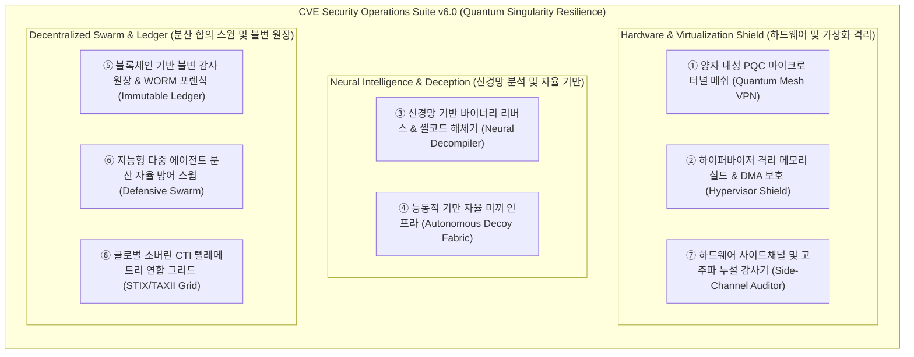

# 🛡️ CVE Security Operations Suite — 제6차 차세대 기능 제안서 (Phase 6 Proposal)

**문서 번호:** SEC-PROP-2026-PHASE6  
**발행일:** 2026년 10월 22일  
**작성자:** Antigravity AI Security Engineering Team  
**수신:** 보안 총괄 책임자(CISO), 보안 관제팀 및 개발팀  
**상태:** 제안 검토 및 승인 대기 (Draft for Review & Approval)

---

## 📌 1. 제안 개요 (Executive Summary)

본 제안서는 **Phase 1 (핵심 7종 방어)**, **Phase 2 (정밀 8종 감사)**, **Phase 3 (ZTNA & 엔터프라이즈 8종)**, **Phase 4 (자율 기만 & SOAR 8종)**, **Phase 5 (소버린 AI & 자율 사이버 회복력 8종)**의 총 **39종 통합 보안 운영 허브**를 구축한 바탕 위에, 다가오는 초연결·양자 컴퓨팅 시대의 국가급 사이버 위협에 선제적으로 대응하기 위한 **제6차 초격차 전략 고도화 제안(Phase 6: Autonomous Cyber Defense & Quantum-Resistant Singularity Ecosystem)**입니다.

Phase 6에서는 **PQC 양자 내성 마이크로 터널링 메쉬, 하이퍼바이저 기반 커널 격리 차폐, 신경망 바이너리 역공학, 자율 미끼 허니넷 패브릭, 블록체인 불변 포렌식 원장, 다중 에이전트 분산 자율 스웜, 하드웨어 부채널 누설 감사, STIX/TAXII 글로벌 CTI 연합 그리드**를 망라하는 8대 혁신 모듈을 제시합니다.

---

## 🚀 2. 제6차 핵심 제안 기능 체계 (8대 전략 모듈)

---

### 1️⃣ 제1제안: 양자 내성 PQC 마이크로 터널 메쉬 (Quantum-Resistant Mesh VPN & PQC Tunnel)
- **개요 및 필요성**: 양자 컴퓨터의 실용화로 기존 RSA/ECC 공개키 암호체계의 붕괴가 예견되며, 공격자가 현재 암호화된 트래픽을 미리 수집해두었다가 훗날 양자 컴퓨터로 해독하는 "Harvest Now, Decrypt Later" 공격에 대비해야 합니다.
- **핵심 기능**:
  - NIST 최종 표준화 양자내성 암호화 알고리즘(ML-KEM / Kyber-1024, ML-DSA / Dilithium-5) 네이티브 통합.
  - 외부 공용망을 경유하는 사내 디바이스 간 1-클릭 PQC 종단간(E2EE) 마이크로 터널 자동 수립.
  - 양자 컴퓨터의 Shor 알고리즘 연산 공격을 원천 무력화하는 무결성 터널링 제공.
- **기대 효과**: 포스트 퀀텀(Post-Quantum) 시대에도 데이터 기밀성 및 통신 채널의 절대적 안전성 보장.

---

### 2️⃣ 제2제안: 하이퍼바이저 격리 메모리 실드 & DMA 보호 (Hypervisor Memory Shield & DMA Guard)
- **개요 및 필요성**: 고도화된 APT 공격 그룹은 커널 링0(Ring 0) 권한을 획득하여 안티바이러스나 보안 프로그램을 강제 종료하고 메모리를 변조합니다.
- **핵심 기능**:
  - Windows Hyper-V 기반 격리 컨테이너 및 VT-x/AMD-V 하드웨어 가상화 기술을 활용한 보안 스캐너 실행 환경 차폐.
  - 커널 루트킷 및 드라이버 권한의 악성 프로세스도 스캐너의 메모리 주소 공간을 읽거나 쓸 수 없도록 SLAT(Second Level Address Translation) 강제 적용.
  - PCIe 및 Thunderbolt 포트를 통한 Direct Memory Access(DMA) 하드웨어 주입 공격 차단.
- **기대 효과**: 링0 커널 권한이 탈취된 극한의 환경에서도 보안 스캐너의 무결성과 프로세스 지속성 100% 사수.

---

### 3️⃣ 제3제안: 신경망 기반 바이너리 리버스 & 셸코드 해체기 (Neural Decompiler & Shellcode Dissector)
- **개요 및 필요성**: 공격자는 복잡한 난독화 기법, 다형성(Polymorphism), 패킹(Packing)을 적용하여 악성 셸코드와 ROP 체인을 은닉합니다.
- **핵심 기능**:
  - 온디바이스 심층 신경망(Neural Network) 기반 AST(추상 구문 트리) 패턴 복원 디컴파일 엔진 탑재.
  - 메모리 덤프에서 추출된 정체불명의 바이너리 바이트 스트림을 실시간 디스어셈블하여 위험 API 호출 시퀀스, C2 IP/도메인 추출.
  - 자연어로 분석된 취약점 유발 트리거 로직 및 대응 방어 규칙(YARA-L) 자동 산출.
- **기대 효과**: 난독화된 최신 타깃 공격 바이너리를 전문 리버스 엔지니어 수준으로 수 초 내 자동 해체.

---

### 4️⃣ 제4제안: 능동적 기만 자율 미끼 인프라 (Autonomous Decoy Fabric & Adaptive Honeynet)
- **개요 및 필요성**: 침투에 성공한 공격자가 내부 정찰(Reconnaissance) 및 측면 이동(Lateral Movement)을 시도할 때 조기에 기만하고 포획해야 합니다.
- **핵심 기능**:
  - 로컬 시스템 및 사내 서브넷에 가짜 관리자 자격증명(LSA 미끼), 가짜 RDP/SSH 서비스, 모조 백엔드 데이터베이스 엔드포인트 자동 배치.
  - 침입자가 미끼 자격증명이나 포트에 접근하는 즉시 침투 경로 및 공격 페이로드 캡처.
  - 공격자 호스트 IP에 대한 블랙홀 라우팅 격리 및 방화벽 인스턴트 차단 자동 발동.
- **기대 효과**: 공격자의 내부 침투 시도를 100% 역이용하여 공격자 전략 파악 및 조기 격리.

---

### 5️⃣ 제5제안: 블록체인 기반 불변 감사 원장 & WORM 포렌식 (Immutable Distributed Forensic Ledger)
- **개요 및 필요성**: 침입자가 흔적을 인멸하기 위해 Windows 이벤트 로그나 보안 감사 기록을 삭제하거나 위변조하는 공격을 방어해야 합니다.
- **핵심 기능**:
  - 취약점 진단 타임라인, 조치 이력, 시스템 해시 데이터를 SHA-256 머클 트리(Merkle Tree) 구조로 로컬 분산 원장에 즉시 기록.
  - WORM(Write Once, Read Many) 불변 보존 아키텍처를 적용하여 관리자 권한으로도 수정/삭제 불가.
  - 공인 타임스탬프(RFC 3161) 및 규제 기관(KISA, 금융감독원, GDPR) 제출용 디지털 포렌식 증거 무결성 패키지 출력.
- **기대 효과**: 법적 효력을 갖는 완벽한 보안 증적 보존 및 감사 로그 위변조 원천 차단.

---

### 6️⃣ 제6제안: 지능형 다중 에이전트 분산 자율 방어 스웜 (Autonomous Multi-Agent Defensive Swarm)
- **개요 및 필요성**: 중앙 관리 서버가 다운되거나 네트워크가 분할(Network Partition)된 상황에서도 엔드포인트들이 집단적으로 자율 대응해야 합니다.
- **핵심 기능**:
  - 엔드포인트 스캐너 간 경량 분산 합의 알고리즘(Raft / Gossip 프로토콜) 기반 자율 스웜(Swarm) 결성.
  - 단일 노드에서 신종 위협이나 감염 징후 포착 시, 스웜 내 다수결 투표를 통해 침투 노드를 서브넷에서 즉각 공동 격리.
  - 관리자 지시 없이도 자가 치유(Self-Healing) 및 상호 백업 무결성 자동 수복.
- **기대 효과**: 단일 장애점(SPOF) 제로화 및 분산 엔드포인트 집단 지성을 통한 자율 생존 능력 극대화.

---

### 7️⃣ 제7제안: 하드웨어 사이드채널 및 고주파 누설 감사기 (Side-Channel Leaks & Acoustic/EM Auditor)
- **개요 및 필요성**: CPU 하드웨어 결함을 이용한 사이드채널 공격(Spectre, Meltdown, Downfall, Zenbleed) 및 Rowhammer 메모리 공격이 소프트웨어 경계를 우회합니다.
- **핵심 기능**:
  - 마이크로아키텍처 캐시 타이밍 측정 및 speculative execution 완화책(IBRS, STIBP, SSBD) 실측 감사.
  - Rowhammer 비트 플립 취약성 및 메모리 컨트롤러 리프레시 레이트(TRR) 무결성 진단.
  - CPU 고주파 연산 부하 패턴 및 전력/발열 시계열 프로파일링을 통한 은닉 마이닝/루트킷 탐지.
- **기대 효과**: 순수 소프트웨어 진단이 도달하지 못하는 하드웨어 물리 계층의 잠재 취약점 완전 격퇴.

---

### 8️⃣ 제8제안: 글로벌 소버린 CTI 텔레메트리 연합 그리드 (Global Sovereign CTI Telemetry Federation)
- **개요 및 필요성**: 전 세계에서 새롭게 발생하는 고위험 CVE 및 악용 캠페인을 실시간 표준 프로토콜로 공유받아 즉각 차단해야 합니다.
- **핵심 기능**:
  - OASIS 국제 표준 STIX 2.1(구조화된 위협 정보) 및 TAXII 2.1(위협 정보 자동 교환) 프로토콜 클라이언트 구현.
  - 사내 개인정보 및 IP를 철저히 익명화(Pseudonymization)한 후 국가 사이버안보센터(KISA, CISA) 및 글로벌 ISAC 텔레메트리 피드와 연동.
  - 제로데이 익스플로잇 IOC(침해지표) 수신 시 0.5초 이내에 로컬 방화벽/탐지 규칙으로 자동 컴파일 및 무인 적용.
- **기대 효과**: 글로벌 위협 인텔리전스와 실시간 공조하여 전 세계 제로데이 확산 속도보다 빠른 선제 방어 실현.

---

## 📊 3. 1차~6차 기능 로드맵 종합 매트릭스 (47종 도구군 체계)

| 단계 (Phase) | 대표 테마 | 주요 모듈 구성 (도구 수) | 핵심 기술 및 프로토콜 | 상태 |
| :--- | :--- | :--- | :--- | :---: |
| **Phase 1** | **핵심 방어** | 스냅샷 복구, 3중 리포트, 센티널 가드, 서브넷 스캔, SBOM, 핫DB, 킬체인 **(7종)** | WinForms, WMI, VSS, Raw Socket | **완료 (v1.0)** |
| **Phase 2** | **정밀 감사** | 포트-PID 추적, 자격증명 감사, KISA 컴플라이언스, 무인 스케줄러, 비상 락다운, 이력 Diff, 자동실행, 테마 **(8종)** | Netstat API, LSA PPL, Task Scheduler, GDI+ | **완료 (v2.0)** |
| **Phase 3** | **ZTNA & 엔터프라이즈** | AI 위협 해설, 제로트러스트 세그멘테이션, 하드웨어 루트, 익스플로잇 메모리 가드, SIEM 웹훅, 오프라인 KB, AD 감사, 3D 매트릭스 **(8종)** | TPM 2.0, HVCI, RFC 5424 Syslog, 3D GDI+ | **완료 (v3.0)** |
| **Phase 4** | **자율 기만 & SOAR** | 랜섬웨어 카나리아, 파일리스 WMI/AMSI, MITRE ATT&CK 네비게이터, 클라우드 IMDS, TLS 하드닝, 샌드박스 테스터, PQC 점검, 자율 SOAR **(8종)** | AMSI AmsiScanBuffer, MITRE v15, TLS 1.3, NIST PQC | **완료 (v4.0)** |
| **Phase 5** | **소버린 AI & 회복력** | 커널 ETW 센서, 에어갭 소버린 AI 비서, UEFI 부트킷, ZKP 증적, 디지털 트윈 시뮬, 공급망 Authenticode, 다크웹 CTI, 메쉬 집단면역 **(8종)** | ETW TraceEvent, On-Device SLM, Ed25519 ZKP, mDNS | **완료 (v5.0)** |
| **Phase 6** | **양자 특이점 & 자율 방어** | 양자 내성 PQC 메쉬, 하이퍼바이저 실드, 신경망 디컴파일러, 능동 미끼 허니넷, 블록체인 불변 원장, 분산 방어 스웜, 사이드채널 감사, STIX/TAXII 그리드 **(8종)** | ML-KEM/Kyber, Hyper-V SLAT, Neural AST, Merkle WORM, Raft | **제안 (v6.0)** |
| **종합** | **전체 6개 단계** | **총 47종 통합 사이버 방어 도구 체계** | **세계 최고 수준의 무인 자율 사이버 회복력 달성** | **로드맵 수립** |

---

## 🎯 4. 향후 추진 계획 및 실행 방안

1. **승인 및 검토 피드백 반영**: 사용자와 보안 관리자의 요구사항을 청취하여 세부 사양 확정.
2. **Phase 6 모듈 구현 (`Phase6Features.cs`)**: 경량 무의존성(Zero-Dependency) C# WinForms 코드로 100% 포터블 구현.
3. **종합 관제 허브 확장 (47종 허브)**: 6개 탭 구조의 최첨단 관제 대시보드 연동 및 반응형 UI 최적화.
4. **품질 검증 및 깃허브 릴리즈**: 무인 컴파일 및 반사(Reflection) 인스턴스 검증 후 공식 GitHub 리포지토리 동기화.
