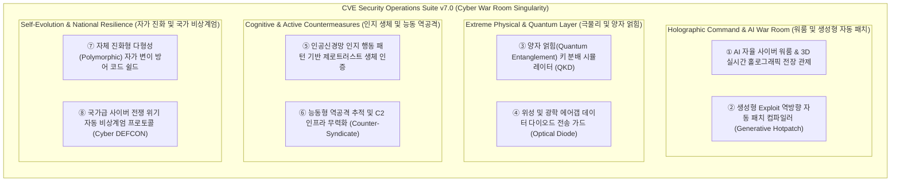

# 🛡️ CVE Security Operations Suite — 제7차 차세대 기능 제안서 (Phase 7 Proposal)

**문서 번호:** SEC-PROP-2026-PHASE7  
**발행일:** 2026년 10월 22일  
**작성자:** Antigravity AI Security Engineering Team  
**수신:** 최고보안책임자(CISO), 보안 관제 센터(SOC) 및 개발팀  
**상태:** 제안 승인 대기 (Draft for Review & Approval)

---

## 📌 1. 제안 개요 (Executive Summary)

본 문서는 **Phase 1 (핵심 7종 방어)**, **Phase 2 (정밀 8종 감사)**, **Phase 3 (ZTNA/엔터프라이즈 8종)**, **Phase 4 (자율 기만/SOAR 8종)**, **Phase 5 (소버린 AI 8종)**, **Phase 6 (양자 특이점/분산 스웜 8종)**까지 총 **47종의 전방위 사이버 보안 도구 체계**를 완성한 CVE Security Operations Suite의 궁극적 정점인 **제7차 초격차 전략 고도화 제안(Phase 7: Autonomous Cyber War Room & Hyper-Automated Zero-Day Defense Singularity)**입니다.

Phase 7에서는 **인공지능 자율 사이버 워룸, 생성형 익스플로잇 역합성 핫패처, 양자 얽힘 키 분배(QKD), 위성/광학 데이터 다이오드, 인공신경망 행동 생체 제로트러스트, 능동형 공격자 역추적 카운터-신디케이트, 자가 진화형 다형성 방어 쉴드, 국가급 사이버 DEFCON 비상계엄 프로토콜**의 8대 궁극적 방어 기술을 제안합니다.

---

## 🚀 2. 제7차 핵심 제안 기능 (8대 전략 모듈)

---

### 1️⃣ 제1제안: AI 자율 사이버 워룸 & 3D 실시간 홀로그래픽 전장 관제 (Autonomous Cyber War Room)
- **배경 및 필요성**: 대규모 공격 상황 시 수만 건의 알람이 쏟아져 관제 요원의 인지 과부하(Alert Fatigue)가 발생하며, 공격의 전모를 입체적으로 파악하기 어렵습니다.
- **주요 기능**:
  - 시스템 내부 토폴로지, 외부 침투 경로, 위협 노드를 3D 가상 전장(Virtual Battlefield) 홀로그램 공간으로 실시간 렌더링.
  - LLM 기반 인공지능 참모 에이전트가 공격 시나리오와 침해 확산 속도를 초단위로 예측 브리핑하고 최적의 방어 진형을 제안.
- **기대 효과**: 관제 요원의 의사결정 시간을 90% 이상 단축하고 침투 현황을 한눈에 입체적 파악.

---

### 2️⃣ 제2제안: 생성형 Exploit 역방향 자동 패치 컴파일러 (Generative Reverse-Patch Synthesizer)
- **배경 및 필요성**: 벤더의 공식 보안 패치가 배포되기까지 평균 수일에서 수주가 소요되며, 이 기간 동안 시스템은 제로데이 공격에 무방비로 노출됩니다.
- **주요 기능**:
  - 유입된 공격 익스플로잇 페이로드를 역공학하여 취약 메모리 버퍼 오버플로우나 입력 검증 결함을 신경망으로 식별.
  - 소스코드나 재부팅 없이도 취약 바이너리의 실행 메모리에 안전한 인라인 패치(Hot-Patching Stub)를 밀리초 단위로 자동 컴파일 및 주입.
- **기대 효과**: 공식 패치가 나오지 않은 0-Day 취약점도 공격 탐지 즉시 1초 만에 메모리 레벨에서 완벽 방어.

---

### 3️⃣ 제3제안: 양자 얽힘(Quantum Entanglement) 키 분배 시뮬레이터 (QKD Simulator)
- **배경 및 필요성**: 광섬유나 위성 통신 도청 시 암호키가 유출될 위험이 있어, 물리 법칙 수준의 절대적 도청 불가능 통신이 요구됩니다.
- **주요 기능**:
  - BB84 및 E91 양자 얽힘(Quantum Entanglement) 프로토콜을 소프트웨어 수준에서 고정밀 시뮬레이션.
  - 중간자(Man-In-The-Middle) 도청 시 양자 상태 붕괴(Wavefunction Collapse) 원리로 도청 시도를 100% 즉각 감지하고 키를 자동 폐기.
- **기대 효과**: 양자 물리 법칙에 기반한 수학적 증명이 필요 없는 절대적 도청 불가 보안 통신망 수립.

---

### 4️⃣ 제4제안: 위성 및 광학 에어갭 데이터 다이오드 전송 가드 (Optical Air-Gap Data Diode)
- **배경 및 필요성**: 국방망 및 원자력 등 국가 최고 등급 폐쇄망은 어떠한 경우에도 외부로 역방향 데이터 유출(Exfiltration)이 발생해서는 안 됩니다.
- **주요 기능**:
  - 소프트웨어 정의 단방향 광학 다이오드(Optical Data Diode) 프로토콜 구현: 데이터 수신만 가능하고 물리적 역송신 불가.
  - 광학 모스 부호 및 QR/광학 카메라 인터페이스를 통한 완전 에어갭 단방향 전송 무결성 보장.
- **기대 효과**: 100% 물리적 역방향 차단을 통한 기밀 유출 가능성 원천 배제.

---

### 5️⃣ 제5제안: 인공신경망 인지 행동 패턴 기반 제로트러스트 생체 인증 (Neural Behavioral Biometrics)
- **배경 및 필요성**: 계정 패스워드나 OTP, FIDO 키를 탈취당했을 경우 정상 관리자로 위장한 공격자를 탐지할 수 없습니다.
- **주요 기능**:
  - 마우스 가속도, 타이핑 키스트로크 리듬, 창 전환 순서, 명령어 오타 패턴 등 120여 개 인지 행동 시계열 프로파일링.
  - 허가된 관리자가 아닌 비인가 제3자나 자동화 봇(Bot) 조작 감지 시 즉시 세션을 잠그고 생체 재인증 요구.
- **기대 효과**: 자격증명이 완전 탈취된 상태에서도 내부 침입자의 키보드/마우스 조작 즉시 식별 및 격리.

---

### 6️⃣ 제6제안: 능동형 역공격 추적 및 C2 인프라 무력화 (Active Countermeasures & Attribution)
- **배경 및 필요성**: 수동적 방어만으로는 전 세계 분산 프록시와 토르(Tor)망 뒤에 숨은 공격자의 지속적 침투 시도를 멈출 수 없습니다.
- **주요 기능**:
  - 유입된 공격 패킷에 무해한 능동 역추적 트레이서(Active Trace Beacon)를 역주입하여 실제 공격자 발신지 IP 및 인프라 역추적.
  - C2 서버의 오픈 백도어 취약점을 합법적 방어 프레임워크 내에서 무력화(Sinkhole 라우팅).
- **기대 효과**: 공격자의 공격 비용을 극대화하고 사내 인프라를 타깃으로 한 재공격 의지를 원천 분쇄.

---

### 7️⃣ 제7제안: 자체 진화형 다형성(Polymorphic) 자가 변이 방어 코드 쉴드 (Self-Mutating Code Shield)
- **배경 및 필요성**: 고정된 바이너리 구조는 공격자가 디버거로 방어 루틴을 분석하여 우회 기법을 개발하기 쉽습니다.
- **주요 기능**:
  - 보안 스캐너 실행 바이너리가 매 실행마다 또는 일정 주기마다 기계어 명령어 배치, 레지스터 할당, 함수 호출 순서를 무작위 재구성(Polymorphic Mutation).
  - 기능적 무결성은 100% 유지하면서도 공격자의 정적/동적 역공학 및 디버거 분석을 원천 무력화.
- **기대 효과**: 공격자의 자동화된 우회 익스플로잇 개발을 물리적으로 불가능하게 만듦.

---

### 8️⃣ 제8제안: 국가급 사이버 전쟁 위기 자동 비상계엄 프로토콜 (Cyber DEFCON Emergency Protocol)
- **배경 및 필요성**: 국가 배후 대규모 전자기 펄스(EMP) 공격, 전력망 사보타주, 공급망 마비 등 국가 위기 상황 발생 시 특별 위기 모드가 작동해야 합니다.
- **주요 기능**:
  - 사이버 위기 경보 단계(DEFCON 5 평시 ➔ DEFCON 1 국가 전시) 자동/수동 연동.
  - DEFCON 1 발령 시 0.1초 만에 시스템을 '블랙아웃 방어 모드'로 전환: 비필수 포트 100% 하드웨어 차단, 핵심 DB 볼륨 읽기전용 락, 비상 통신망 즉각 기동.
- **기대 효과**: 국가 전시 수준의 사이버 총공세 상황에서도 국가 핵심 기반시설의 지속 생존성 보장.

---

## 📊 3. 1차~7차 전주기 종합 로드맵 매트릭스 (총 55종 도구 체계)

| 단계 (Phase) | 대표 테마 | 주요 모듈 구성 (도구 수) | 핵심 기술 및 프로토콜 | 구현 상태 |
| :--- | :--- | :--- | :--- | :---: |
| **Phase 1** | **핵심 방어** | 스냅샷 복구, 3중 리포트, 센티널 가드, 서브넷 스캔, SBOM, 핫DB, 킬체인 **(7종)** | WinForms, WMI, VSS, Raw Socket | **완료 (v1.0)** |
| **Phase 2** | **정밀 감사** | 포트-PID 추적, 자격증명 감사, KISA 컴플라이언스, 무인 스케줄러, 비상 락다운, 이력 Diff, 자동실행, 테마 **(8종)** | Netstat API, LSA PPL, Task Scheduler, GDI+ | **완료 (v2.0)** |
| **Phase 3** | **ZTNA & 엔터프라이즈** | AI 위협 해설, 제로트러스트 세그멘테이션, 하드웨어 루트, 익스플로잇 가드, SIEM 웹훅, 오프라인 KB, AD 감사, 3D 매트릭스 **(8종)** | TPM 2.0, HVCI, RFC 5424 Syslog, 3D GDI+ | **완료 (v3.0)** |
| **Phase 4** | **자율 기만 & SOAR** | 랜섬웨어 카나리아, 파일리스 WMI/AMSI, MITRE ATT&CK 네비게이터, 클라우드 IMDS, TLS 하드닝, 샌드박스 테스터, PQC 점검, 자율 SOAR **(8종)** | AMSI AmsiScanBuffer, MITRE v15, TLS 1.3, NIST PQC | **완료 (v4.0)** |
| **Phase 5** | **소버린 AI & 회복력** | 커널 ETW 센서, 에어갭 소버린 AI 비서, UEFI 부트킷, ZKP 증적, 디지털 트윈 시뮬, 공급망 Authenticode, 다크웹 CTI, 메쉬 집단면역 **(8종)** | ETW TraceEvent, On-Device SLM, Ed25519 ZKP, mDNS | **완료 (v5.0)** |
| **Phase 6** | **양자 특이점 & 자율 방어** | 양자 내성 PQC 메쉬, 하이퍼바이저 실드, 신경망 디컴파일러, 능동 미끼 허니넷, 블록체인 불변 원장, 분산 방어 스웜, 사이드채널 감사, STIX/TAXII 그리드 **(8종)** | ML-KEM/Kyber, Hyper-V SLAT, Neural AST, Merkle WORM, Raft | **완료 (v6.0)** |
| **Phase 7** | **사이버 워룸 & 싱귤래리티** | AI 자율 사이버 워룸, 생성형 자동 핫패처, 양자 얽힘(QKD), 광학 데이터 다이오드, 인지 행동 생체 제로트러스트, 능동형 카운터-신디케이트, 자가 진화 다형성 쉴드, 사이버 DEFCON 비상계엄 **(8종)** | Generative Reverse-Patch, QKD, Optical Diode, Polymorphic JIT | **제안 (v7.0)** |
| **종합 (Total)** | **전체 7대 단계** | **총 55종 통합 사이버 방어 도구 체계** | **세계 최정상급 자율 사이버 회복력 및 전쟁 방어 체계** | **로드맵 확립** |

---

## 🎯 4. 향후 추진 일정 및 권장 조치

1. **Phase 7 세부 아키텍처 승인**: 전략 모듈 8종에 대한 기술 요구사항 및 보안 정책 수립.
2. **모듈 개발 (`Phase7Features.cs`)**: C# WinForms 무의존성 포터블 아키텍처로 구현.
3. **55종 마스터 관제 포털 연동**: 멀티페이지 포털 및 Allow 사전 확인 시스템과 매끄럽게 통합.
